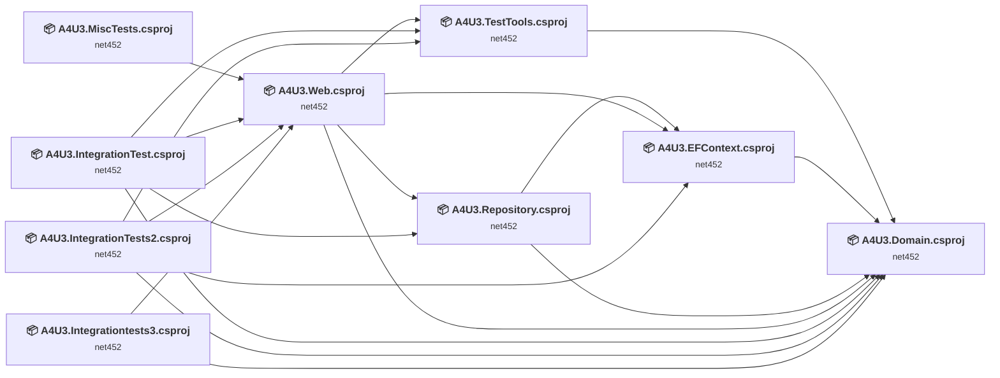
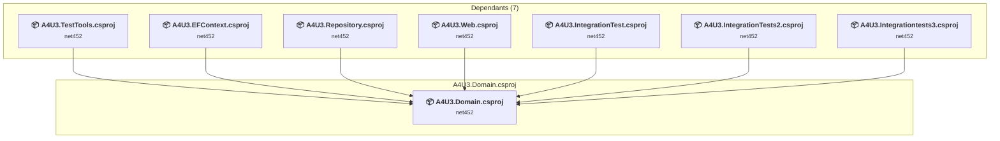
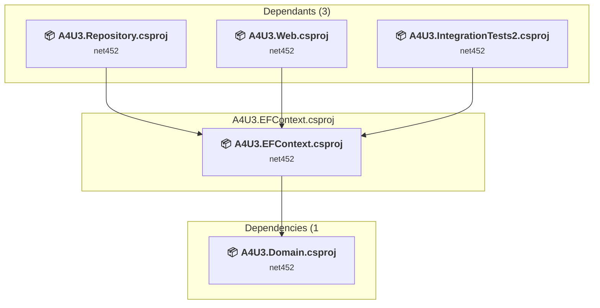
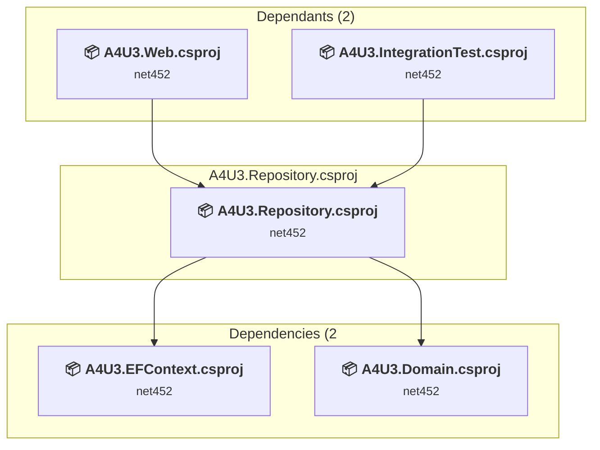
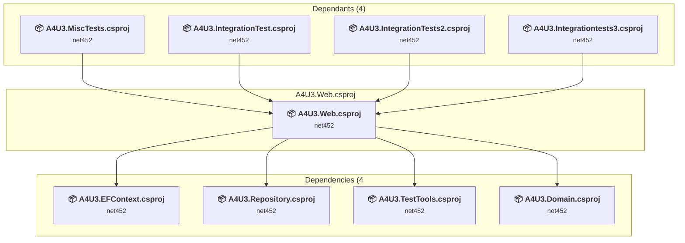
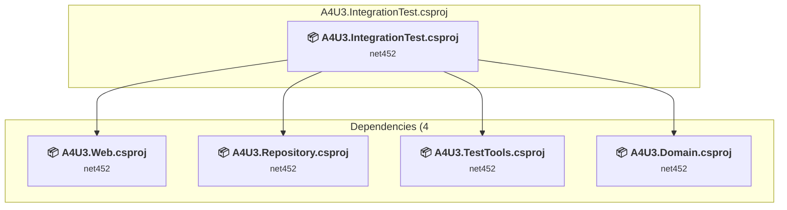
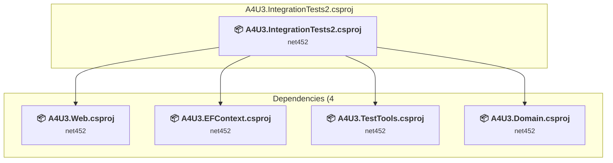
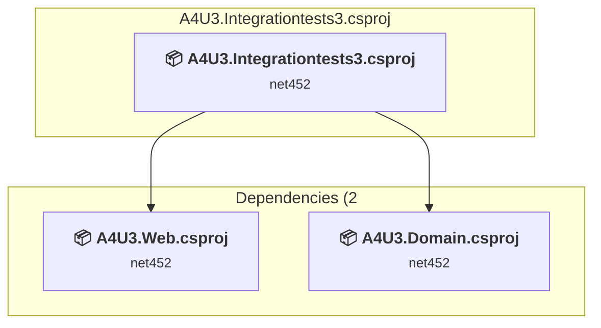
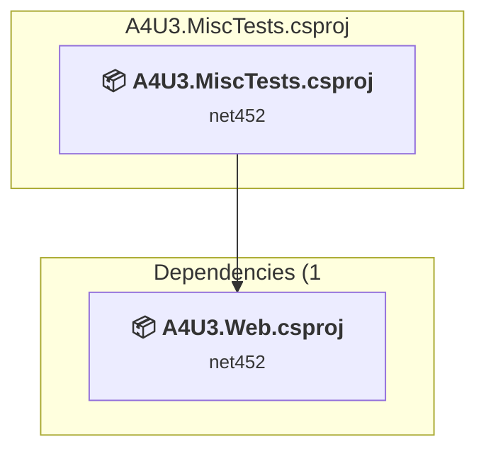
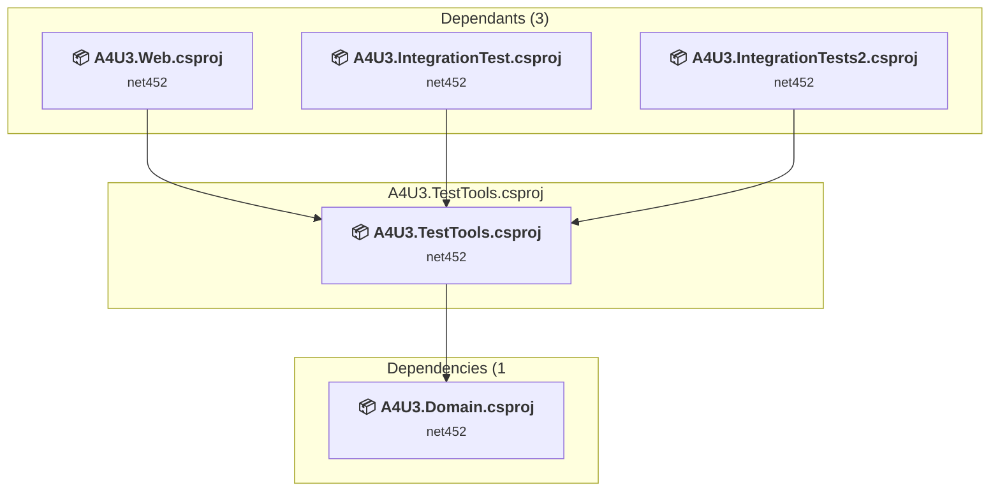

# Projects and dependencies analysis

This document provides a comprehensive overview of the projects and their dependencies in the context of upgrading to .NETCoreApp,Version=v10.0.

## Table of Contents

- [Executive Summary](#executive-Summary)
  - [Highlevel Metrics](#highlevel-metrics)
  - [Projects Compatibility](#projects-compatibility)
  - [Package Compatibility](#package-compatibility)
  - [API Compatibility](#api-compatibility)
  - [Binding Redirect Configuration](#binding-redirect-configuration)
- [Aggregate NuGet packages details](#aggregate-nuget-packages-details)
- [Top API Migration Challenges](#top-api-migration-challenges)
  - [Technologies and Features](#technologies-and-features)
  - [Most Frequent API Issues](#most-frequent-api-issues)
- [Projects Relationship Graph](#projects-relationship-graph)
- [Project Details](#project-details)

  - [src\A4U3.Domain\A4U3.Domain.csproj](#srca4u3domaina4u3domaincsproj)
  - [src\A4U3.EFContext\A4U3.EFContext.csproj](#srca4u3efcontexta4u3efcontextcsproj)
  - [src\A4U3.Repository\A4U3.Repository.csproj](#srca4u3repositorya4u3repositorycsproj)
  - [src\A4U3.Web\A4U3.Web.csproj](#srca4u3weba4u3webcsproj)
  - [test\A4U3.IntegrationTest\A4U3.IntegrationTest.csproj](#testa4u3integrationtesta4u3integrationtestcsproj)
  - [test\A4U3.IntegrationTests2\A4U3.IntegrationTests2.csproj](#testa4u3integrationtests2a4u3integrationtests2csproj)
  - [test\A4U3.Integrationtests3\A4U3.Integrationtests3.csproj](#testa4u3integrationtests3a4u3integrationtests3csproj)
  - [test\A4U3.MiscTests\A4U3.MiscTests.csproj](#testa4u3misctestsa4u3misctestscsproj)
  - [test\A4U3.TestTools\A4U3.TestTools.csproj](#testa4u3testtoolsa4u3testtoolscsproj)

## Executive Summary

### Highlevel Metrics

| Metric | Count | Status |
| :--- | :---: | :--- |
| Total Projects | 9 | All require upgrade |
| Total NuGet Packages | 162 | 17 need upgrade |
| Total Code Files | 150 |  |
| Total Code Files with Incidents | 26 |  |
| Total Lines of Code | 9015 |  |
| Total Number of Issues | 168 |  |
| Estimated LOC to modify | 89+ | at least 1.0% of codebase |

### Projects Compatibility

| Project | Target Framework | Difficulty | Package Issues | API Issues | Binding Issues | Est. LOC Impact | Description |
| :--- | :---: | :---: | :---: | :---: | :---: | :---: | :--- |
| [src\A4U3.Domain\A4U3.Domain.csproj](#srca4u3domaina4u3domaincsproj) | net452 | 🟢 Low | 7 | 0 | 0 |  | ClassLibrary, Sdk Style = True |
| [src\A4U3.EFContext\A4U3.EFContext.csproj](#srca4u3efcontexta4u3efcontextcsproj) | net452 | 🟢 Low | 19 | 3 | 0 | 3+ | ClassLibrary, Sdk Style = True |
| [src\A4U3.Repository\A4U3.Repository.csproj](#srca4u3repositorya4u3repositorycsproj) | net452 | 🟢 Low | 1 | 0 | 0 |  | ClassLibrary, Sdk Style = True |
| [src\A4U3.Web\A4U3.Web.csproj](#srca4u3weba4u3webcsproj) | net452 | 🟡 Medium | 32 | 33 | 0 | 33+ | AspNetCore, Sdk Style = True |
| [test\A4U3.IntegrationTest\A4U3.IntegrationTest.csproj](#testa4u3integrationtesta4u3integrationtestcsproj) | net452 | 🟢 Low | 1 | 2 | 0 | 2+ | ClassLibrary, Sdk Style = True |
| [test\A4U3.IntegrationTests2\A4U3.IntegrationTests2.csproj](#testa4u3integrationtests2a4u3integrationtests2csproj) | net452 | 🟢 Low | 4 | 24 | 0 | 24+ | ClassLibrary, Sdk Style = True |
| [test\A4U3.Integrationtests3\A4U3.Integrationtests3.csproj](#testa4u3integrationtests3a4u3integrationtests3csproj) | net452 | 🟢 Low | 4 | 27 | 0 | 27+ | ClassLibrary, Sdk Style = True |
| [test\A4U3.MiscTests\A4U3.MiscTests.csproj](#testa4u3misctestsa4u3misctestscsproj) | net452 | 🟢 Low | 1 | 0 | 0 |  | ClassLibrary, Sdk Style = True |
| [test\A4U3.TestTools\A4U3.TestTools.csproj](#testa4u3testtoolsa4u3testtoolscsproj) | net452 | 🟢 Low | 1 | 0 | 0 |  | ClassLibrary, Sdk Style = True |

### Package Compatibility

| Status | Count | Percentage |
| :--- | :---: | :---: |
| ✅ Compatible | 145 | 89.5% |
| ⚠️ Incompatible | 3 | 1.9% |
| 🔄 Upgrade Recommended | 14 | 8.6% |
| ***Total NuGet Packages*** | ***162*** | ***100%*** |

### API Compatibility

| Category | Count | Impact |
| :--- | :---: | :--- |
| 🔴 Binary Incompatible | 18 | High - Require code changes |
| 🟡 Source Incompatible | 51 | Medium - Needs re-compilation and potential conflicting API error fixing |
| 🔵 Behavioral change | 20 | Low - Behavioral changes that may require testing at runtime |
| ✅ Compatible | 5437 |  |
| ***Total APIs Analyzed*** | ***5526*** |  |

## Aggregate NuGet packages details

| Package | Current Version | Suggested Version | Projects | Description |
| :--- | :---: | :---: | :--- | :--- |
| cloudscribe.Web.Pagination | 1.0.3 |  | [A4U3.IntegrationTest.csproj](#testa4u3integrationtesta4u3integrationtestcsproj) [A4U3.IntegrationTests2.csproj](#testa4u3integrationtests2a4u3integrationtests2csproj) [A4U3.Integrationtests3.csproj](#testa4u3integrationtests3a4u3integrationtests3csproj) [A4U3.MiscTests.csproj](#testa4u3misctestsa4u3misctestscsproj) [A4U3.Web.csproj](#srca4u3weba4u3webcsproj) | ✅Compatible |
| FluentAssertions | 5.0.0-beta0002 |  | [A4U3.IntegrationTest.csproj](#testa4u3integrationtesta4u3integrationtestcsproj) [A4U3.IntegrationTests2.csproj](#testa4u3integrationtests2a4u3integrationtests2csproj) [A4U3.Integrationtests3.csproj](#testa4u3integrationtests3a4u3integrationtests3csproj) [A4U3.MiscTests.csproj](#testa4u3misctestsa4u3misctestscsproj) | ✅Compatible |
| Libuv | 1.9.0 |  | [A4U3.IntegrationTest.csproj](#testa4u3integrationtesta4u3integrationtestcsproj) [A4U3.IntegrationTests2.csproj](#testa4u3integrationtests2a4u3integrationtests2csproj) [A4U3.Integrationtests3.csproj](#testa4u3integrationtests3a4u3integrationtests3csproj) [A4U3.MiscTests.csproj](#testa4u3misctestsa4u3misctestscsproj) [A4U3.Web.csproj](#srca4u3weba4u3webcsproj) | ✅Compatible |
| Microsoft.ApplicationInsights | 2.1.0 |  | [A4U3.IntegrationTest.csproj](#testa4u3integrationtesta4u3integrationtestcsproj) [A4U3.IntegrationTests2.csproj](#testa4u3integrationtests2a4u3integrationtests2csproj) [A4U3.Integrationtests3.csproj](#testa4u3integrationtests3a4u3integrationtests3csproj) [A4U3.MiscTests.csproj](#testa4u3misctestsa4u3misctestscsproj) [A4U3.Web.csproj](#srca4u3weba4u3webcsproj) | ✅Compatible |
| Microsoft.ApplicationInsights.Agent.Intercept | 1.2.1 |  | [A4U3.IntegrationTest.csproj](#testa4u3integrationtesta4u3integrationtestcsproj) [A4U3.IntegrationTests2.csproj](#testa4u3integrationtests2a4u3integrationtests2csproj) [A4U3.Integrationtests3.csproj](#testa4u3integrationtests3a4u3integrationtests3csproj) [A4U3.MiscTests.csproj](#testa4u3misctestsa4u3misctestscsproj) [A4U3.Web.csproj](#srca4u3weba4u3webcsproj) | ✅Compatible |
| Microsoft.ApplicationInsights.AspNetCore | 1.0.0 |  | [A4U3.IntegrationTest.csproj](#testa4u3integrationtesta4u3integrationtestcsproj) [A4U3.IntegrationTests2.csproj](#testa4u3integrationtests2a4u3integrationtests2csproj) [A4U3.Integrationtests3.csproj](#testa4u3integrationtests3a4u3integrationtests3csproj) [A4U3.MiscTests.csproj](#testa4u3misctestsa4u3misctestscsproj) [A4U3.Web.csproj](#srca4u3weba4u3webcsproj) | ⚠️NuGet package is deprecated |
| Microsoft.ApplicationInsights.DependencyCollector | 2.1.0 |  | [A4U3.IntegrationTest.csproj](#testa4u3integrationtesta4u3integrationtestcsproj) [A4U3.IntegrationTests2.csproj](#testa4u3integrationtests2a4u3integrationtests2csproj) [A4U3.Integrationtests3.csproj](#testa4u3integrationtests3a4u3integrationtests3csproj) [A4U3.MiscTests.csproj](#testa4u3misctestsa4u3misctestscsproj) [A4U3.Web.csproj](#srca4u3weba4u3webcsproj) | ✅Compatible |
| Microsoft.ApplicationInsights.PerfCounterCollector | 2.1.0 |  | [A4U3.IntegrationTest.csproj](#testa4u3integrationtesta4u3integrationtestcsproj) [A4U3.IntegrationTests2.csproj](#testa4u3integrationtests2a4u3integrationtests2csproj) [A4U3.Integrationtests3.csproj](#testa4u3integrationtests3a4u3integrationtests3csproj) [A4U3.MiscTests.csproj](#testa4u3misctestsa4u3misctestscsproj) [A4U3.Web.csproj](#srca4u3weba4u3webcsproj) | ✅Compatible |
| Microsoft.ApplicationInsights.WindowsServer.TelemetryChannel | 2.1.0 |  | [A4U3.IntegrationTest.csproj](#testa4u3integrationtesta4u3integrationtestcsproj) [A4U3.IntegrationTests2.csproj](#testa4u3integrationtests2a4u3integrationtests2csproj) [A4U3.Integrationtests3.csproj](#testa4u3integrationtests3a4u3integrationtests3csproj) [A4U3.MiscTests.csproj](#testa4u3misctestsa4u3misctestscsproj) [A4U3.Web.csproj](#srca4u3weba4u3webcsproj) | ✅Compatible |
| Microsoft.AspNet.WebApi.Client | 5.2.3 | 6.0.0 | [A4U3.IntegrationTests2.csproj](#testa4u3integrationtests2a4u3integrationtests2csproj) [A4U3.Integrationtests3.csproj](#testa4u3integrationtests3a4u3integrationtests3csproj) | ⚠️NuGet package is incompatible |
| Microsoft.AspNetCore.Antiforgery | 1.0.3 |  | [A4U3.IntegrationTest.csproj](#testa4u3integrationtesta4u3integrationtestcsproj) [A4U3.IntegrationTests2.csproj](#testa4u3integrationtests2a4u3integrationtests2csproj) [A4U3.Integrationtests3.csproj](#testa4u3integrationtests3a4u3integrationtests3csproj) [A4U3.MiscTests.csproj](#testa4u3misctestsa4u3misctestscsproj) [A4U3.Web.csproj](#srca4u3weba4u3webcsproj) | ✅Compatible |
| Microsoft.AspNetCore.Authentication | 1.0.2 |  | [A4U3.Domain.csproj](#srca4u3domaina4u3domaincsproj) [A4U3.EFContext.csproj](#srca4u3efcontexta4u3efcontextcsproj) [A4U3.IntegrationTest.csproj](#testa4u3integrationtesta4u3integrationtestcsproj) [A4U3.IntegrationTests2.csproj](#testa4u3integrationtests2a4u3integrationtests2csproj) [A4U3.Integrationtests3.csproj](#testa4u3integrationtests3a4u3integrationtests3csproj) [A4U3.MiscTests.csproj](#testa4u3misctestsa4u3misctestscsproj) [A4U3.Repository.csproj](#srca4u3repositorya4u3repositorycsproj) [A4U3.TestTools.csproj](#testa4u3testtoolsa4u3testtoolscsproj) [A4U3.Web.csproj](#srca4u3weba4u3webcsproj) | ✅Compatible |
| Microsoft.AspNetCore.Authentication.Cookies | 1.0.2 |  | [A4U3.Domain.csproj](#srca4u3domaina4u3domaincsproj) [A4U3.EFContext.csproj](#srca4u3efcontexta4u3efcontextcsproj) [A4U3.IntegrationTest.csproj](#testa4u3integrationtesta4u3integrationtestcsproj) [A4U3.IntegrationTests2.csproj](#testa4u3integrationtests2a4u3integrationtests2csproj) [A4U3.Integrationtests3.csproj](#testa4u3integrationtests3a4u3integrationtests3csproj) [A4U3.MiscTests.csproj](#testa4u3misctestsa4u3misctestscsproj) [A4U3.Repository.csproj](#srca4u3repositorya4u3repositorycsproj) [A4U3.TestTools.csproj](#testa4u3testtoolsa4u3testtoolscsproj) [A4U3.Web.csproj](#srca4u3weba4u3webcsproj) | ✅Compatible |
| Microsoft.AspNetCore.Authorization | 1.0.2 |  | [A4U3.IntegrationTest.csproj](#testa4u3integrationtesta4u3integrationtestcsproj) [A4U3.IntegrationTests2.csproj](#testa4u3integrationtests2a4u3integrationtests2csproj) [A4U3.Integrationtests3.csproj](#testa4u3integrationtests3a4u3integrationtests3csproj) [A4U3.MiscTests.csproj](#testa4u3misctestsa4u3misctestscsproj) [A4U3.Web.csproj](#srca4u3weba4u3webcsproj) | ✅Compatible |
| Microsoft.AspNetCore.Cors | 1.0.2 |  | [A4U3.IntegrationTest.csproj](#testa4u3integrationtesta4u3integrationtestcsproj) [A4U3.IntegrationTests2.csproj](#testa4u3integrationtests2a4u3integrationtests2csproj) [A4U3.Integrationtests3.csproj](#testa4u3integrationtests3a4u3integrationtests3csproj) [A4U3.MiscTests.csproj](#testa4u3misctestsa4u3misctestscsproj) [A4U3.Web.csproj](#srca4u3weba4u3webcsproj) | ✅Compatible |
| Microsoft.AspNetCore.Cryptography.Internal | 1.0.2 |  | [A4U3.Domain.csproj](#srca4u3domaina4u3domaincsproj) [A4U3.EFContext.csproj](#srca4u3efcontexta4u3efcontextcsproj) [A4U3.IntegrationTest.csproj](#testa4u3integrationtesta4u3integrationtestcsproj) [A4U3.IntegrationTests2.csproj](#testa4u3integrationtests2a4u3integrationtests2csproj) [A4U3.Integrationtests3.csproj](#testa4u3integrationtests3a4u3integrationtests3csproj) [A4U3.MiscTests.csproj](#testa4u3misctestsa4u3misctestscsproj) [A4U3.Repository.csproj](#srca4u3repositorya4u3repositorycsproj) [A4U3.TestTools.csproj](#testa4u3testtoolsa4u3testtoolscsproj) [A4U3.Web.csproj](#srca4u3weba4u3webcsproj) | ✅Compatible |
| Microsoft.AspNetCore.Cryptography.KeyDerivation | 1.0.2 |  | [A4U3.Domain.csproj](#srca4u3domaina4u3domaincsproj) [A4U3.EFContext.csproj](#srca4u3efcontexta4u3efcontextcsproj) [A4U3.IntegrationTest.csproj](#testa4u3integrationtesta4u3integrationtestcsproj) [A4U3.IntegrationTests2.csproj](#testa4u3integrationtests2a4u3integrationtests2csproj) [A4U3.Integrationtests3.csproj](#testa4u3integrationtests3a4u3integrationtests3csproj) [A4U3.MiscTests.csproj](#testa4u3misctestsa4u3misctestscsproj) [A4U3.Repository.csproj](#srca4u3repositorya4u3repositorycsproj) [A4U3.TestTools.csproj](#testa4u3testtoolsa4u3testtoolscsproj) [A4U3.Web.csproj](#srca4u3weba4u3webcsproj) | ✅Compatible |
| Microsoft.AspNetCore.DataProtection | 1.0.2 |  | [A4U3.Domain.csproj](#srca4u3domaina4u3domaincsproj) [A4U3.EFContext.csproj](#srca4u3efcontexta4u3efcontextcsproj) [A4U3.IntegrationTest.csproj](#testa4u3integrationtesta4u3integrationtestcsproj) [A4U3.IntegrationTests2.csproj](#testa4u3integrationtests2a4u3integrationtests2csproj) [A4U3.Integrationtests3.csproj](#testa4u3integrationtests3a4u3integrationtests3csproj) [A4U3.MiscTests.csproj](#testa4u3misctestsa4u3misctestscsproj) [A4U3.Repository.csproj](#srca4u3repositorya4u3repositorycsproj) [A4U3.TestTools.csproj](#testa4u3testtoolsa4u3testtoolscsproj) [A4U3.Web.csproj](#srca4u3weba4u3webcsproj) | ✅Compatible |
| Microsoft.AspNetCore.DataProtection.Abstractions | 1.0.2 |  | [A4U3.Domain.csproj](#srca4u3domaina4u3domaincsproj) [A4U3.EFContext.csproj](#srca4u3efcontexta4u3efcontextcsproj) [A4U3.IntegrationTest.csproj](#testa4u3integrationtesta4u3integrationtestcsproj) [A4U3.IntegrationTests2.csproj](#testa4u3integrationtests2a4u3integrationtests2csproj) [A4U3.Integrationtests3.csproj](#testa4u3integrationtests3a4u3integrationtests3csproj) [A4U3.MiscTests.csproj](#testa4u3misctestsa4u3misctestscsproj) [A4U3.Repository.csproj](#srca4u3repositorya4u3repositorycsproj) [A4U3.TestTools.csproj](#testa4u3testtoolsa4u3testtoolscsproj) [A4U3.Web.csproj](#srca4u3weba4u3webcsproj) | ✅Compatible |
| Microsoft.AspNetCore.Diagnostics | 1.0.2 |  | [A4U3.IntegrationTest.csproj](#testa4u3integrationtesta4u3integrationtestcsproj) [A4U3.IntegrationTests2.csproj](#testa4u3integrationtests2a4u3integrationtests2csproj) [A4U3.Integrationtests3.csproj](#testa4u3integrationtests3a4u3integrationtests3csproj) [A4U3.MiscTests.csproj](#testa4u3misctestsa4u3misctestscsproj) [A4U3.Web.csproj](#srca4u3weba4u3webcsproj) | NuGet package functionality is included with framework reference |
| Microsoft.AspNetCore.Diagnostics.Abstractions | 1.0.2 |  | [A4U3.IntegrationTest.csproj](#testa4u3integrationtesta4u3integrationtestcsproj) [A4U3.IntegrationTests2.csproj](#testa4u3integrationtests2a4u3integrationtests2csproj) [A4U3.Integrationtests3.csproj](#testa4u3integrationtests3a4u3integrationtests3csproj) [A4U3.MiscTests.csproj](#testa4u3misctestsa4u3misctestscsproj) [A4U3.Web.csproj](#srca4u3weba4u3webcsproj) | ✅Compatible |
| Microsoft.AspNetCore.Hosting | 1.0.2 |  | [A4U3.IntegrationTest.csproj](#testa4u3integrationtesta4u3integrationtestcsproj) [A4U3.IntegrationTests2.csproj](#testa4u3integrationtests2a4u3integrationtests2csproj) [A4U3.Integrationtests3.csproj](#testa4u3integrationtests3a4u3integrationtests3csproj) [A4U3.MiscTests.csproj](#testa4u3misctestsa4u3misctestscsproj) [A4U3.Web.csproj](#srca4u3weba4u3webcsproj) | ✅Compatible |
| Microsoft.AspNetCore.Hosting.Abstractions | 1.0.2 |  | [A4U3.Domain.csproj](#srca4u3domaina4u3domaincsproj) [A4U3.EFContext.csproj](#srca4u3efcontexta4u3efcontextcsproj) [A4U3.IntegrationTest.csproj](#testa4u3integrationtesta4u3integrationtestcsproj) [A4U3.IntegrationTests2.csproj](#testa4u3integrationtests2a4u3integrationtests2csproj) [A4U3.Integrationtests3.csproj](#testa4u3integrationtests3a4u3integrationtests3csproj) [A4U3.MiscTests.csproj](#testa4u3misctestsa4u3misctestscsproj) [A4U3.Repository.csproj](#srca4u3repositorya4u3repositorycsproj) [A4U3.TestTools.csproj](#testa4u3testtoolsa4u3testtoolscsproj) [A4U3.Web.csproj](#srca4u3weba4u3webcsproj) | ✅Compatible |
| Microsoft.AspNetCore.Hosting.Server.Abstractions | 1.0.2 |  | [A4U3.Domain.csproj](#srca4u3domaina4u3domaincsproj) [A4U3.EFContext.csproj](#srca4u3efcontexta4u3efcontextcsproj) [A4U3.IntegrationTest.csproj](#testa4u3integrationtesta4u3integrationtestcsproj) [A4U3.IntegrationTests2.csproj](#testa4u3integrationtests2a4u3integrationtests2csproj) [A4U3.Integrationtests3.csproj](#testa4u3integrationtests3a4u3integrationtests3csproj) [A4U3.MiscTests.csproj](#testa4u3misctestsa4u3misctestscsproj) [A4U3.Repository.csproj](#srca4u3repositorya4u3repositorycsproj) [A4U3.TestTools.csproj](#testa4u3testtoolsa4u3testtoolscsproj) [A4U3.Web.csproj](#srca4u3weba4u3webcsproj) | ✅Compatible |
| Microsoft.AspNetCore.Html.Abstractions | 1.0.2 |  | [A4U3.IntegrationTest.csproj](#testa4u3integrationtesta4u3integrationtestcsproj) [A4U3.IntegrationTests2.csproj](#testa4u3integrationtests2a4u3integrationtests2csproj) [A4U3.Integrationtests3.csproj](#testa4u3integrationtests3a4u3integrationtests3csproj) [A4U3.MiscTests.csproj](#testa4u3misctestsa4u3misctestscsproj) [A4U3.Web.csproj](#srca4u3weba4u3webcsproj) | ✅Compatible |
| Microsoft.AspNetCore.Http | 1.0.2 |  | [A4U3.Domain.csproj](#srca4u3domaina4u3domaincsproj) [A4U3.EFContext.csproj](#srca4u3efcontexta4u3efcontextcsproj) [A4U3.IntegrationTest.csproj](#testa4u3integrationtesta4u3integrationtestcsproj) [A4U3.IntegrationTests2.csproj](#testa4u3integrationtests2a4u3integrationtests2csproj) [A4U3.Integrationtests3.csproj](#testa4u3integrationtests3a4u3integrationtests3csproj) [A4U3.MiscTests.csproj](#testa4u3misctestsa4u3misctestscsproj) [A4U3.Repository.csproj](#srca4u3repositorya4u3repositorycsproj) [A4U3.TestTools.csproj](#testa4u3testtoolsa4u3testtoolscsproj) [A4U3.Web.csproj](#srca4u3weba4u3webcsproj) | ✅Compatible |
| Microsoft.AspNetCore.Http.Abstractions | 1.0.2 |  | [A4U3.Domain.csproj](#srca4u3domaina4u3domaincsproj) [A4U3.EFContext.csproj](#srca4u3efcontexta4u3efcontextcsproj) [A4U3.IntegrationTest.csproj](#testa4u3integrationtesta4u3integrationtestcsproj) [A4U3.IntegrationTests2.csproj](#testa4u3integrationtests2a4u3integrationtests2csproj) [A4U3.Integrationtests3.csproj](#testa4u3integrationtests3a4u3integrationtests3csproj) [A4U3.MiscTests.csproj](#testa4u3misctestsa4u3misctestscsproj) [A4U3.Repository.csproj](#srca4u3repositorya4u3repositorycsproj) [A4U3.TestTools.csproj](#testa4u3testtoolsa4u3testtoolscsproj) [A4U3.Web.csproj](#srca4u3weba4u3webcsproj) | ✅Compatible |
| Microsoft.AspNetCore.Http.Extensions | 1.0.2 |  | [A4U3.Domain.csproj](#srca4u3domaina4u3domaincsproj) [A4U3.EFContext.csproj](#srca4u3efcontexta4u3efcontextcsproj) [A4U3.IntegrationTest.csproj](#testa4u3integrationtesta4u3integrationtestcsproj) [A4U3.IntegrationTests2.csproj](#testa4u3integrationtests2a4u3integrationtests2csproj) [A4U3.Integrationtests3.csproj](#testa4u3integrationtests3a4u3integrationtests3csproj) [A4U3.MiscTests.csproj](#testa4u3misctestsa4u3misctestscsproj) [A4U3.Repository.csproj](#srca4u3repositorya4u3repositorycsproj) [A4U3.TestTools.csproj](#testa4u3testtoolsa4u3testtoolscsproj) [A4U3.Web.csproj](#srca4u3weba4u3webcsproj) | ✅Compatible |
| Microsoft.AspNetCore.Http.Features | 1.0.2 |  | [A4U3.Domain.csproj](#srca4u3domaina4u3domaincsproj) [A4U3.EFContext.csproj](#srca4u3efcontexta4u3efcontextcsproj) [A4U3.IntegrationTest.csproj](#testa4u3integrationtesta4u3integrationtestcsproj) [A4U3.IntegrationTests2.csproj](#testa4u3integrationtests2a4u3integrationtests2csproj) [A4U3.Integrationtests3.csproj](#testa4u3integrationtests3a4u3integrationtests3csproj) [A4U3.MiscTests.csproj](#testa4u3misctestsa4u3misctestscsproj) [A4U3.Repository.csproj](#srca4u3repositorya4u3repositorycsproj) [A4U3.TestTools.csproj](#testa4u3testtoolsa4u3testtoolscsproj) [A4U3.Web.csproj](#srca4u3weba4u3webcsproj) | ✅Compatible |
| Microsoft.AspNetCore.HttpOverrides | 1.0.2 |  | [A4U3.IntegrationTest.csproj](#testa4u3integrationtesta4u3integrationtestcsproj) [A4U3.IntegrationTests2.csproj](#testa4u3integrationtests2a4u3integrationtests2csproj) [A4U3.Integrationtests3.csproj](#testa4u3integrationtests3a4u3integrationtests3csproj) [A4U3.MiscTests.csproj](#testa4u3misctestsa4u3misctestscsproj) [A4U3.Web.csproj](#srca4u3weba4u3webcsproj) | ✅Compatible |
| Microsoft.AspNetCore.Identity | 1.0.2 |  | [A4U3.Domain.csproj](#srca4u3domaina4u3domaincsproj) [A4U3.EFContext.csproj](#srca4u3efcontexta4u3efcontextcsproj) [A4U3.IntegrationTest.csproj](#testa4u3integrationtesta4u3integrationtestcsproj) [A4U3.IntegrationTests2.csproj](#testa4u3integrationtests2a4u3integrationtests2csproj) [A4U3.Integrationtests3.csproj](#testa4u3integrationtests3a4u3integrationtests3csproj) [A4U3.MiscTests.csproj](#testa4u3misctestsa4u3misctestscsproj) [A4U3.Repository.csproj](#srca4u3repositorya4u3repositorycsproj) [A4U3.TestTools.csproj](#testa4u3testtoolsa4u3testtoolscsproj) [A4U3.Web.csproj](#srca4u3weba4u3webcsproj) | ✅Compatible |
| Microsoft.AspNetCore.Identity.EntityFrameworkCore | 1.0.2 | 10.0.12 | [A4U3.Domain.csproj](#srca4u3domaina4u3domaincsproj) [A4U3.EFContext.csproj](#srca4u3efcontexta4u3efcontextcsproj) [A4U3.IntegrationTest.csproj](#testa4u3integrationtesta4u3integrationtestcsproj) [A4U3.IntegrationTests2.csproj](#testa4u3integrationtests2a4u3integrationtests2csproj) [A4U3.Integrationtests3.csproj](#testa4u3integrationtests3a4u3integrationtests3csproj) [A4U3.MiscTests.csproj](#testa4u3misctestsa4u3misctestscsproj) [A4U3.Repository.csproj](#srca4u3repositorya4u3repositorycsproj) [A4U3.TestTools.csproj](#testa4u3testtoolsa4u3testtoolscsproj) [A4U3.Web.csproj](#srca4u3weba4u3webcsproj) | NuGet package upgrade is recommended |
| Microsoft.AspNetCore.JsonPatch | 1.0.0 |  | [A4U3.IntegrationTest.csproj](#testa4u3integrationtesta4u3integrationtestcsproj) [A4U3.IntegrationTests2.csproj](#testa4u3integrationtests2a4u3integrationtests2csproj) [A4U3.Integrationtests3.csproj](#testa4u3integrationtests3a4u3integrationtests3csproj) [A4U3.MiscTests.csproj](#testa4u3misctestsa4u3misctestscsproj) [A4U3.Web.csproj](#srca4u3weba4u3webcsproj) | ✅Compatible |
| Microsoft.AspNetCore.Localization | 1.0.2 |  | [A4U3.IntegrationTest.csproj](#testa4u3integrationtesta4u3integrationtestcsproj) [A4U3.IntegrationTests2.csproj](#testa4u3integrationtests2a4u3integrationtests2csproj) [A4U3.Integrationtests3.csproj](#testa4u3integrationtests3a4u3integrationtests3csproj) [A4U3.MiscTests.csproj](#testa4u3misctestsa4u3misctestscsproj) [A4U3.Web.csproj](#srca4u3weba4u3webcsproj) | ✅Compatible |
| Microsoft.AspNetCore.Mvc | 1.0.3 |  | [A4U3.IntegrationTest.csproj](#testa4u3integrationtesta4u3integrationtestcsproj) [A4U3.IntegrationTests2.csproj](#testa4u3integrationtests2a4u3integrationtests2csproj) [A4U3.Integrationtests3.csproj](#testa4u3integrationtests3a4u3integrationtests3csproj) [A4U3.MiscTests.csproj](#testa4u3misctestsa4u3misctestscsproj) [A4U3.Web.csproj](#srca4u3weba4u3webcsproj) | NuGet package functionality is included with framework reference |
| Microsoft.AspNetCore.Mvc.Abstractions | 1.0.3 |  | [A4U3.IntegrationTest.csproj](#testa4u3integrationtesta4u3integrationtestcsproj) [A4U3.IntegrationTests2.csproj](#testa4u3integrationtests2a4u3integrationtests2csproj) [A4U3.Integrationtests3.csproj](#testa4u3integrationtests3a4u3integrationtests3csproj) [A4U3.MiscTests.csproj](#testa4u3misctestsa4u3misctestscsproj) [A4U3.Web.csproj](#srca4u3weba4u3webcsproj) | ✅Compatible |
| Microsoft.AspNetCore.Mvc.ApiExplorer | 1.0.3 |  | [A4U3.IntegrationTest.csproj](#testa4u3integrationtesta4u3integrationtestcsproj) [A4U3.IntegrationTests2.csproj](#testa4u3integrationtests2a4u3integrationtests2csproj) [A4U3.Integrationtests3.csproj](#testa4u3integrationtests3a4u3integrationtests3csproj) [A4U3.MiscTests.csproj](#testa4u3misctestsa4u3misctestscsproj) [A4U3.Web.csproj](#srca4u3weba4u3webcsproj) | ✅Compatible |
| Microsoft.AspNetCore.Mvc.Core | 1.0.3 |  | [A4U3.IntegrationTest.csproj](#testa4u3integrationtesta4u3integrationtestcsproj) [A4U3.IntegrationTests2.csproj](#testa4u3integrationtests2a4u3integrationtests2csproj) [A4U3.Integrationtests3.csproj](#testa4u3integrationtests3a4u3integrationtests3csproj) [A4U3.MiscTests.csproj](#testa4u3misctestsa4u3misctestscsproj) [A4U3.Web.csproj](#srca4u3weba4u3webcsproj) | ✅Compatible |
| Microsoft.AspNetCore.Mvc.Cors | 1.0.3 |  | [A4U3.IntegrationTest.csproj](#testa4u3integrationtesta4u3integrationtestcsproj) [A4U3.IntegrationTests2.csproj](#testa4u3integrationtests2a4u3integrationtests2csproj) [A4U3.Integrationtests3.csproj](#testa4u3integrationtests3a4u3integrationtests3csproj) [A4U3.MiscTests.csproj](#testa4u3misctestsa4u3misctestscsproj) [A4U3.Web.csproj](#srca4u3weba4u3webcsproj) | ✅Compatible |
| Microsoft.AspNetCore.Mvc.DataAnnotations | 1.0.3 |  | [A4U3.IntegrationTest.csproj](#testa4u3integrationtesta4u3integrationtestcsproj) [A4U3.IntegrationTests2.csproj](#testa4u3integrationtests2a4u3integrationtests2csproj) [A4U3.Integrationtests3.csproj](#testa4u3integrationtests3a4u3integrationtests3csproj) [A4U3.MiscTests.csproj](#testa4u3misctestsa4u3misctestscsproj) [A4U3.Web.csproj](#srca4u3weba4u3webcsproj) | ✅Compatible |
| Microsoft.AspNetCore.Mvc.Formatters.Json | 1.0.3 |  | [A4U3.IntegrationTest.csproj](#testa4u3integrationtesta4u3integrationtestcsproj) [A4U3.IntegrationTests2.csproj](#testa4u3integrationtests2a4u3integrationtests2csproj) [A4U3.Integrationtests3.csproj](#testa4u3integrationtests3a4u3integrationtests3csproj) [A4U3.MiscTests.csproj](#testa4u3misctestsa4u3misctestscsproj) [A4U3.Web.csproj](#srca4u3weba4u3webcsproj) | ✅Compatible |
| Microsoft.AspNetCore.Mvc.Localization | 1.0.3 |  | [A4U3.IntegrationTest.csproj](#testa4u3integrationtesta4u3integrationtestcsproj) [A4U3.IntegrationTests2.csproj](#testa4u3integrationtests2a4u3integrationtests2csproj) [A4U3.Integrationtests3.csproj](#testa4u3integrationtests3a4u3integrationtests3csproj) [A4U3.MiscTests.csproj](#testa4u3misctestsa4u3misctestscsproj) [A4U3.Web.csproj](#srca4u3weba4u3webcsproj) | ✅Compatible |
| Microsoft.AspNetCore.Mvc.Razor | 1.0.3 |  | [A4U3.IntegrationTest.csproj](#testa4u3integrationtesta4u3integrationtestcsproj) [A4U3.IntegrationTests2.csproj](#testa4u3integrationtests2a4u3integrationtests2csproj) [A4U3.Integrationtests3.csproj](#testa4u3integrationtests3a4u3integrationtests3csproj) [A4U3.MiscTests.csproj](#testa4u3misctestsa4u3misctestscsproj) [A4U3.Web.csproj](#srca4u3weba4u3webcsproj) | ✅Compatible |
| Microsoft.AspNetCore.Mvc.Razor.Host | 1.0.3 |  | [A4U3.IntegrationTest.csproj](#testa4u3integrationtesta4u3integrationtestcsproj) [A4U3.IntegrationTests2.csproj](#testa4u3integrationtests2a4u3integrationtests2csproj) [A4U3.Integrationtests3.csproj](#testa4u3integrationtests3a4u3integrationtests3csproj) [A4U3.MiscTests.csproj](#testa4u3misctestsa4u3misctestscsproj) [A4U3.Web.csproj](#srca4u3weba4u3webcsproj) | ✅Compatible |
| Microsoft.AspNetCore.Mvc.TagHelpers | 1.0.3 |  | [A4U3.IntegrationTest.csproj](#testa4u3integrationtesta4u3integrationtestcsproj) [A4U3.IntegrationTests2.csproj](#testa4u3integrationtests2a4u3integrationtests2csproj) [A4U3.Integrationtests3.csproj](#testa4u3integrationtests3a4u3integrationtests3csproj) [A4U3.MiscTests.csproj](#testa4u3misctestsa4u3misctestscsproj) [A4U3.Web.csproj](#srca4u3weba4u3webcsproj) | ✅Compatible |
| Microsoft.AspNetCore.Mvc.ViewFeatures | 1.0.3 |  | [A4U3.IntegrationTest.csproj](#testa4u3integrationtesta4u3integrationtestcsproj) [A4U3.IntegrationTests2.csproj](#testa4u3integrationtests2a4u3integrationtests2csproj) [A4U3.Integrationtests3.csproj](#testa4u3integrationtests3a4u3integrationtests3csproj) [A4U3.MiscTests.csproj](#testa4u3misctestsa4u3misctestscsproj) [A4U3.Web.csproj](#srca4u3weba4u3webcsproj) | ✅Compatible |
| Microsoft.AspNetCore.Razor | 1.0.2 |  | [A4U3.IntegrationTest.csproj](#testa4u3integrationtesta4u3integrationtestcsproj) [A4U3.IntegrationTests2.csproj](#testa4u3integrationtests2a4u3integrationtests2csproj) [A4U3.Integrationtests3.csproj](#testa4u3integrationtests3a4u3integrationtests3csproj) [A4U3.MiscTests.csproj](#testa4u3misctestsa4u3misctestscsproj) [A4U3.Web.csproj](#srca4u3weba4u3webcsproj) | ✅Compatible |
| Microsoft.AspNetCore.Razor.Runtime | 1.0.2 |  | [A4U3.IntegrationTest.csproj](#testa4u3integrationtesta4u3integrationtestcsproj) [A4U3.IntegrationTests2.csproj](#testa4u3integrationtests2a4u3integrationtests2csproj) [A4U3.Integrationtests3.csproj](#testa4u3integrationtests3a4u3integrationtests3csproj) [A4U3.MiscTests.csproj](#testa4u3misctestsa4u3misctestscsproj) [A4U3.Web.csproj](#srca4u3weba4u3webcsproj) | ✅Compatible |
| Microsoft.AspNetCore.Routing | 1.0.3 |  | [A4U3.IntegrationTest.csproj](#testa4u3integrationtesta4u3integrationtestcsproj) [A4U3.IntegrationTests2.csproj](#testa4u3integrationtests2a4u3integrationtests2csproj) [A4U3.Integrationtests3.csproj](#testa4u3integrationtests3a4u3integrationtests3csproj) [A4U3.MiscTests.csproj](#testa4u3misctestsa4u3misctestscsproj) [A4U3.Web.csproj](#srca4u3weba4u3webcsproj) | ✅Compatible |
| Microsoft.AspNetCore.Routing.Abstractions | 1.0.3 |  | [A4U3.IntegrationTest.csproj](#testa4u3integrationtesta4u3integrationtestcsproj) [A4U3.IntegrationTests2.csproj](#testa4u3integrationtests2a4u3integrationtests2csproj) [A4U3.Integrationtests3.csproj](#testa4u3integrationtests3a4u3integrationtests3csproj) [A4U3.MiscTests.csproj](#testa4u3misctestsa4u3misctestscsproj) [A4U3.Web.csproj](#srca4u3weba4u3webcsproj) | ✅Compatible |
| Microsoft.AspNetCore.Server.IISIntegration | 1.0.2 |  | [A4U3.IntegrationTest.csproj](#testa4u3integrationtesta4u3integrationtestcsproj) [A4U3.IntegrationTests2.csproj](#testa4u3integrationtests2a4u3integrationtests2csproj) [A4U3.Integrationtests3.csproj](#testa4u3integrationtests3a4u3integrationtests3csproj) [A4U3.MiscTests.csproj](#testa4u3misctestsa4u3misctestscsproj) [A4U3.Web.csproj](#srca4u3weba4u3webcsproj) | NuGet package functionality is included with framework reference |
| Microsoft.AspNetCore.Server.Kestrel | 1.0.3 |  | [A4U3.IntegrationTest.csproj](#testa4u3integrationtesta4u3integrationtestcsproj) [A4U3.IntegrationTests2.csproj](#testa4u3integrationtests2a4u3integrationtests2csproj) [A4U3.Integrationtests3.csproj](#testa4u3integrationtests3a4u3integrationtests3csproj) [A4U3.MiscTests.csproj](#testa4u3misctestsa4u3misctestscsproj) [A4U3.Web.csproj](#srca4u3weba4u3webcsproj) | NuGet package functionality is included with framework reference |
| Microsoft.AspNetCore.Session | 1.0.2 |  | [A4U3.IntegrationTest.csproj](#testa4u3integrationtesta4u3integrationtestcsproj) [A4U3.IntegrationTests2.csproj](#testa4u3integrationtests2a4u3integrationtests2csproj) [A4U3.Integrationtests3.csproj](#testa4u3integrationtests3a4u3integrationtests3csproj) [A4U3.MiscTests.csproj](#testa4u3misctestsa4u3misctestscsproj) [A4U3.Web.csproj](#srca4u3weba4u3webcsproj) | NuGet package functionality is included with framework reference |
| Microsoft.AspNetCore.StaticFiles | 1.0.2 |  | [A4U3.IntegrationTest.csproj](#testa4u3integrationtesta4u3integrationtestcsproj) [A4U3.IntegrationTests2.csproj](#testa4u3integrationtests2a4u3integrationtests2csproj) [A4U3.Integrationtests3.csproj](#testa4u3integrationtests3a4u3integrationtests3csproj) [A4U3.MiscTests.csproj](#testa4u3misctestsa4u3misctestscsproj) [A4U3.Web.csproj](#srca4u3weba4u3webcsproj) | NuGet package functionality is included with framework reference |
| Microsoft.AspNetCore.TestHost | 1.0.2 | 10.0.12 | [A4U3.IntegrationTests2.csproj](#testa4u3integrationtests2a4u3integrationtests2csproj) [A4U3.Integrationtests3.csproj](#testa4u3integrationtests3a4u3integrationtests3csproj) | NuGet package upgrade is recommended |
| Microsoft.AspNetCore.WebUtilities | 1.0.2 |  | [A4U3.Domain.csproj](#srca4u3domaina4u3domaincsproj) [A4U3.EFContext.csproj](#srca4u3efcontexta4u3efcontextcsproj) [A4U3.IntegrationTest.csproj](#testa4u3integrationtesta4u3integrationtestcsproj) [A4U3.IntegrationTests2.csproj](#testa4u3integrationtests2a4u3integrationtests2csproj) [A4U3.Integrationtests3.csproj](#testa4u3integrationtests3a4u3integrationtests3csproj) [A4U3.MiscTests.csproj](#testa4u3misctestsa4u3misctestscsproj) [A4U3.Repository.csproj](#srca4u3repositorya4u3repositorycsproj) [A4U3.TestTools.csproj](#testa4u3testtoolsa4u3testtoolscsproj) [A4U3.Web.csproj](#srca4u3weba4u3webcsproj) | ✅Compatible |
| Microsoft.CodeAnalysis.Analyzers | 1.1.0 |  | [A4U3.IntegrationTest.csproj](#testa4u3integrationtesta4u3integrationtestcsproj) [A4U3.IntegrationTests2.csproj](#testa4u3integrationtests2a4u3integrationtests2csproj) [A4U3.Integrationtests3.csproj](#testa4u3integrationtests3a4u3integrationtests3csproj) [A4U3.MiscTests.csproj](#testa4u3misctestsa4u3misctestscsproj) [A4U3.Web.csproj](#srca4u3weba4u3webcsproj) | ✅Compatible |
| Microsoft.CodeAnalysis.Common | 1.3.0 |  | [A4U3.IntegrationTest.csproj](#testa4u3integrationtesta4u3integrationtestcsproj) [A4U3.IntegrationTests2.csproj](#testa4u3integrationtests2a4u3integrationtests2csproj) [A4U3.Integrationtests3.csproj](#testa4u3integrationtests3a4u3integrationtests3csproj) [A4U3.MiscTests.csproj](#testa4u3misctestsa4u3misctestscsproj) [A4U3.Web.csproj](#srca4u3weba4u3webcsproj) | ✅Compatible |
| Microsoft.CodeAnalysis.CSharp | 1.3.0 |  | [A4U3.IntegrationTest.csproj](#testa4u3integrationtesta4u3integrationtestcsproj) [A4U3.IntegrationTests2.csproj](#testa4u3integrationtests2a4u3integrationtests2csproj) [A4U3.Integrationtests3.csproj](#testa4u3integrationtests3a4u3integrationtests3csproj) [A4U3.MiscTests.csproj](#testa4u3misctestsa4u3misctestscsproj) [A4U3.Web.csproj](#srca4u3weba4u3webcsproj) | ✅Compatible |
| Microsoft.CodeCoverage | 1.0.3 |  | [A4U3.MiscTests.csproj](#testa4u3misctestsa4u3misctestscsproj) | ✅Compatible |
| Microsoft.CSharp | 4.0.1 |  | [A4U3.IntegrationTest.csproj](#testa4u3integrationtesta4u3integrationtestcsproj) [A4U3.IntegrationTests2.csproj](#testa4u3integrationtests2a4u3integrationtests2csproj) [A4U3.Integrationtests3.csproj](#testa4u3integrationtests3a4u3integrationtests3csproj) [A4U3.MiscTests.csproj](#testa4u3misctestsa4u3misctestscsproj) [A4U3.Web.csproj](#srca4u3weba4u3webcsproj) | ✅Compatible |
| Microsoft.DotNet.InternalAbstractions | 1.0.0 |  | [A4U3.IntegrationTest.csproj](#testa4u3integrationtesta4u3integrationtestcsproj) [A4U3.IntegrationTests2.csproj](#testa4u3integrationtests2a4u3integrationtests2csproj) [A4U3.Integrationtests3.csproj](#testa4u3integrationtests3a4u3integrationtests3csproj) [A4U3.MiscTests.csproj](#testa4u3misctestsa4u3misctestscsproj) [A4U3.Web.csproj](#srca4u3weba4u3webcsproj) | ✅Compatible |
| Microsoft.EntityFrameworkCore | 1.0.3 | 10.0.12 | [A4U3.Domain.csproj](#srca4u3domaina4u3domaincsproj) [A4U3.EFContext.csproj](#srca4u3efcontexta4u3efcontextcsproj) [A4U3.IntegrationTest.csproj](#testa4u3integrationtesta4u3integrationtestcsproj) [A4U3.IntegrationTests2.csproj](#testa4u3integrationtests2a4u3integrationtests2csproj) [A4U3.Integrationtests3.csproj](#testa4u3integrationtests3a4u3integrationtests3csproj) [A4U3.MiscTests.csproj](#testa4u3misctestsa4u3misctestscsproj) [A4U3.Repository.csproj](#srca4u3repositorya4u3repositorycsproj) [A4U3.TestTools.csproj](#testa4u3testtoolsa4u3testtoolscsproj) [A4U3.Web.csproj](#srca4u3weba4u3webcsproj) | NuGet package upgrade is recommended |
| Microsoft.EntityFrameworkCore.Design | 1.0.3 | 10.0.12 | [A4U3.EFContext.csproj](#srca4u3efcontexta4u3efcontextcsproj) [A4U3.IntegrationTest.csproj](#testa4u3integrationtesta4u3integrationtestcsproj) [A4U3.IntegrationTests2.csproj](#testa4u3integrationtests2a4u3integrationtests2csproj) [A4U3.Integrationtests3.csproj](#testa4u3integrationtests3a4u3integrationtests3csproj) [A4U3.MiscTests.csproj](#testa4u3misctestsa4u3misctestscsproj) [A4U3.Repository.csproj](#srca4u3repositorya4u3repositorycsproj) [A4U3.Web.csproj](#srca4u3weba4u3webcsproj) | NuGet package upgrade is recommended |
| Microsoft.EntityFrameworkCore.InMemory | 1.0.3 | 10.0.12 | [A4U3.EFContext.csproj](#srca4u3efcontexta4u3efcontextcsproj) [A4U3.IntegrationTest.csproj](#testa4u3integrationtesta4u3integrationtestcsproj) [A4U3.IntegrationTests2.csproj](#testa4u3integrationtests2a4u3integrationtests2csproj) [A4U3.Integrationtests3.csproj](#testa4u3integrationtests3a4u3integrationtests3csproj) [A4U3.MiscTests.csproj](#testa4u3misctestsa4u3misctestscsproj) [A4U3.Repository.csproj](#srca4u3repositorya4u3repositorycsproj) [A4U3.Web.csproj](#srca4u3weba4u3webcsproj) | NuGet package upgrade is recommended |
| Microsoft.EntityFrameworkCore.Relational | 1.0.3 |  | [A4U3.Domain.csproj](#srca4u3domaina4u3domaincsproj) [A4U3.EFContext.csproj](#srca4u3efcontexta4u3efcontextcsproj) [A4U3.IntegrationTest.csproj](#testa4u3integrationtesta4u3integrationtestcsproj) [A4U3.IntegrationTests2.csproj](#testa4u3integrationtests2a4u3integrationtests2csproj) [A4U3.Integrationtests3.csproj](#testa4u3integrationtests3a4u3integrationtests3csproj) [A4U3.MiscTests.csproj](#testa4u3misctestsa4u3misctestscsproj) [A4U3.Repository.csproj](#srca4u3repositorya4u3repositorycsproj) [A4U3.TestTools.csproj](#testa4u3testtoolsa4u3testtoolscsproj) [A4U3.Web.csproj](#srca4u3weba4u3webcsproj) | ✅Compatible |
| Microsoft.EntityFrameworkCore.Relational.Design | 1.0.3 |  | [A4U3.EFContext.csproj](#srca4u3efcontexta4u3efcontextcsproj) [A4U3.IntegrationTest.csproj](#testa4u3integrationtesta4u3integrationtestcsproj) [A4U3.IntegrationTests2.csproj](#testa4u3integrationtests2a4u3integrationtests2csproj) [A4U3.Integrationtests3.csproj](#testa4u3integrationtests3a4u3integrationtests3csproj) [A4U3.MiscTests.csproj](#testa4u3misctestsa4u3misctestscsproj) [A4U3.Repository.csproj](#srca4u3repositorya4u3repositorycsproj) [A4U3.Web.csproj](#srca4u3weba4u3webcsproj) | ✅Compatible |
| Microsoft.EntityFrameworkCore.SqlServer | 1.0.3 | 10.0.12 | [A4U3.Domain.csproj](#srca4u3domaina4u3domaincsproj) [A4U3.EFContext.csproj](#srca4u3efcontexta4u3efcontextcsproj) [A4U3.IntegrationTest.csproj](#testa4u3integrationtesta4u3integrationtestcsproj) [A4U3.IntegrationTests2.csproj](#testa4u3integrationtests2a4u3integrationtests2csproj) [A4U3.Integrationtests3.csproj](#testa4u3integrationtests3a4u3integrationtests3csproj) [A4U3.MiscTests.csproj](#testa4u3misctestsa4u3misctestscsproj) [A4U3.Repository.csproj](#srca4u3repositorya4u3repositorycsproj) [A4U3.TestTools.csproj](#testa4u3testtoolsa4u3testtoolscsproj) [A4U3.Web.csproj](#srca4u3weba4u3webcsproj) | NuGet package upgrade is recommended |
| Microsoft.EntityFrameworkCore.Tools | 1.0.0 | 10.0.12 | [A4U3.EFContext.csproj](#srca4u3efcontexta4u3efcontextcsproj) [A4U3.IntegrationTest.csproj](#testa4u3integrationtesta4u3integrationtestcsproj) [A4U3.IntegrationTests2.csproj](#testa4u3integrationtests2a4u3integrationtests2csproj) [A4U3.Integrationtests3.csproj](#testa4u3integrationtests3a4u3integrationtests3csproj) [A4U3.MiscTests.csproj](#testa4u3misctestsa4u3misctestscsproj) [A4U3.Repository.csproj](#srca4u3repositorya4u3repositorycsproj) [A4U3.Web.csproj](#srca4u3weba4u3webcsproj) | NuGet package upgrade is recommended |
| Microsoft.Extensions.Caching.Abstractions | 1.0.2 |  | [A4U3.Domain.csproj](#srca4u3domaina4u3domaincsproj) [A4U3.EFContext.csproj](#srca4u3efcontexta4u3efcontextcsproj) [A4U3.IntegrationTest.csproj](#testa4u3integrationtesta4u3integrationtestcsproj) [A4U3.IntegrationTests2.csproj](#testa4u3integrationtests2a4u3integrationtests2csproj) [A4U3.Integrationtests3.csproj](#testa4u3integrationtests3a4u3integrationtests3csproj) [A4U3.MiscTests.csproj](#testa4u3misctestsa4u3misctestscsproj) [A4U3.Repository.csproj](#srca4u3repositorya4u3repositorycsproj) [A4U3.TestTools.csproj](#testa4u3testtoolsa4u3testtoolscsproj) [A4U3.Web.csproj](#srca4u3weba4u3webcsproj) | ✅Compatible |
| Microsoft.Extensions.Caching.Memory | 1.0.2 |  | [A4U3.Domain.csproj](#srca4u3domaina4u3domaincsproj) [A4U3.EFContext.csproj](#srca4u3efcontexta4u3efcontextcsproj) [A4U3.IntegrationTest.csproj](#testa4u3integrationtesta4u3integrationtestcsproj) [A4U3.IntegrationTests2.csproj](#testa4u3integrationtests2a4u3integrationtests2csproj) [A4U3.Integrationtests3.csproj](#testa4u3integrationtests3a4u3integrationtests3csproj) [A4U3.MiscTests.csproj](#testa4u3misctestsa4u3misctestscsproj) [A4U3.Repository.csproj](#srca4u3repositorya4u3repositorycsproj) [A4U3.TestTools.csproj](#testa4u3testtoolsa4u3testtoolscsproj) [A4U3.Web.csproj](#srca4u3weba4u3webcsproj) | ✅Compatible |
| Microsoft.Extensions.Configuration | 1.0.2 |  | [A4U3.EFContext.csproj](#srca4u3efcontexta4u3efcontextcsproj) [A4U3.IntegrationTest.csproj](#testa4u3integrationtesta4u3integrationtestcsproj) [A4U3.IntegrationTests2.csproj](#testa4u3integrationtests2a4u3integrationtests2csproj) [A4U3.Integrationtests3.csproj](#testa4u3integrationtests3a4u3integrationtests3csproj) [A4U3.MiscTests.csproj](#testa4u3misctestsa4u3misctestscsproj) [A4U3.Repository.csproj](#srca4u3repositorya4u3repositorycsproj) [A4U3.Web.csproj](#srca4u3weba4u3webcsproj) | ✅Compatible |
| Microsoft.Extensions.Configuration.Abstractions | 1.0.2 |  | [A4U3.Domain.csproj](#srca4u3domaina4u3domaincsproj) [A4U3.EFContext.csproj](#srca4u3efcontexta4u3efcontextcsproj) [A4U3.IntegrationTest.csproj](#testa4u3integrationtesta4u3integrationtestcsproj) [A4U3.IntegrationTests2.csproj](#testa4u3integrationtests2a4u3integrationtests2csproj) [A4U3.Integrationtests3.csproj](#testa4u3integrationtests3a4u3integrationtests3csproj) [A4U3.MiscTests.csproj](#testa4u3misctestsa4u3misctestscsproj) [A4U3.Repository.csproj](#srca4u3repositorya4u3repositorycsproj) [A4U3.TestTools.csproj](#testa4u3testtoolsa4u3testtoolscsproj) [A4U3.Web.csproj](#srca4u3weba4u3webcsproj) | ✅Compatible |
| Microsoft.Extensions.Configuration.Binder | 1.0.2 |  | [A4U3.EFContext.csproj](#srca4u3efcontexta4u3efcontextcsproj) [A4U3.IntegrationTest.csproj](#testa4u3integrationtesta4u3integrationtestcsproj) [A4U3.IntegrationTests2.csproj](#testa4u3integrationtests2a4u3integrationtests2csproj) [A4U3.Integrationtests3.csproj](#testa4u3integrationtests3a4u3integrationtests3csproj) [A4U3.MiscTests.csproj](#testa4u3misctestsa4u3misctestscsproj) [A4U3.Repository.csproj](#srca4u3repositorya4u3repositorycsproj) [A4U3.Web.csproj](#srca4u3weba4u3webcsproj) | ✅Compatible |
| Microsoft.Extensions.Configuration.EnvironmentVariables | 1.0.2 | 10.0.12 | [A4U3.IntegrationTest.csproj](#testa4u3integrationtesta4u3integrationtestcsproj) [A4U3.IntegrationTests2.csproj](#testa4u3integrationtests2a4u3integrationtests2csproj) [A4U3.Integrationtests3.csproj](#testa4u3integrationtests3a4u3integrationtests3csproj) [A4U3.MiscTests.csproj](#testa4u3misctestsa4u3misctestscsproj) [A4U3.Web.csproj](#srca4u3weba4u3webcsproj) | NuGet package upgrade is recommended |
| Microsoft.Extensions.Configuration.FileExtensions | 1.0.2 | 10.0.12 | [A4U3.EFContext.csproj](#srca4u3efcontexta4u3efcontextcsproj) [A4U3.IntegrationTest.csproj](#testa4u3integrationtesta4u3integrationtestcsproj) [A4U3.IntegrationTests2.csproj](#testa4u3integrationtests2a4u3integrationtests2csproj) [A4U3.Integrationtests3.csproj](#testa4u3integrationtests3a4u3integrationtests3csproj) [A4U3.MiscTests.csproj](#testa4u3misctestsa4u3misctestscsproj) [A4U3.Repository.csproj](#srca4u3repositorya4u3repositorycsproj) [A4U3.Web.csproj](#srca4u3weba4u3webcsproj) | NuGet package upgrade is recommended |
| Microsoft.Extensions.Configuration.Json | 1.0.2 | 10.0.12 | [A4U3.EFContext.csproj](#srca4u3efcontexta4u3efcontextcsproj) [A4U3.IntegrationTest.csproj](#testa4u3integrationtesta4u3integrationtestcsproj) [A4U3.IntegrationTests2.csproj](#testa4u3integrationtests2a4u3integrationtests2csproj) [A4U3.Integrationtests3.csproj](#testa4u3integrationtests3a4u3integrationtests3csproj) [A4U3.MiscTests.csproj](#testa4u3misctestsa4u3misctestscsproj) [A4U3.Repository.csproj](#srca4u3repositorya4u3repositorycsproj) [A4U3.Web.csproj](#srca4u3weba4u3webcsproj) | NuGet package upgrade is recommended |
| Microsoft.Extensions.DependencyInjection | 1.0.2 |  | [A4U3.Domain.csproj](#srca4u3domaina4u3domaincsproj) [A4U3.EFContext.csproj](#srca4u3efcontexta4u3efcontextcsproj) [A4U3.IntegrationTest.csproj](#testa4u3integrationtesta4u3integrationtestcsproj) [A4U3.IntegrationTests2.csproj](#testa4u3integrationtests2a4u3integrationtests2csproj) [A4U3.Integrationtests3.csproj](#testa4u3integrationtests3a4u3integrationtests3csproj) [A4U3.MiscTests.csproj](#testa4u3misctestsa4u3misctestscsproj) [A4U3.Repository.csproj](#srca4u3repositorya4u3repositorycsproj) [A4U3.TestTools.csproj](#testa4u3testtoolsa4u3testtoolscsproj) [A4U3.Web.csproj](#srca4u3weba4u3webcsproj) | ✅Compatible |
| Microsoft.Extensions.DependencyInjection.Abstractions | 1.0.2 |  | [A4U3.Domain.csproj](#srca4u3domaina4u3domaincsproj) [A4U3.EFContext.csproj](#srca4u3efcontexta4u3efcontextcsproj) [A4U3.IntegrationTest.csproj](#testa4u3integrationtesta4u3integrationtestcsproj) [A4U3.IntegrationTests2.csproj](#testa4u3integrationtests2a4u3integrationtests2csproj) [A4U3.Integrationtests3.csproj](#testa4u3integrationtests3a4u3integrationtests3csproj) [A4U3.MiscTests.csproj](#testa4u3misctestsa4u3misctestscsproj) [A4U3.Repository.csproj](#srca4u3repositorya4u3repositorycsproj) [A4U3.TestTools.csproj](#testa4u3testtoolsa4u3testtoolscsproj) [A4U3.Web.csproj](#srca4u3weba4u3webcsproj) | ✅Compatible |
| Microsoft.Extensions.DependencyModel | 1.0.0 |  | [A4U3.IntegrationTest.csproj](#testa4u3integrationtesta4u3integrationtestcsproj) [A4U3.IntegrationTests2.csproj](#testa4u3integrationtests2a4u3integrationtests2csproj) [A4U3.Integrationtests3.csproj](#testa4u3integrationtests3a4u3integrationtests3csproj) [A4U3.MiscTests.csproj](#testa4u3misctestsa4u3misctestscsproj) [A4U3.Web.csproj](#srca4u3weba4u3webcsproj) | ✅Compatible |
| Microsoft.Extensions.DiagnosticAdapter | 1.0.0 |  | [A4U3.IntegrationTest.csproj](#testa4u3integrationtesta4u3integrationtestcsproj) [A4U3.IntegrationTests2.csproj](#testa4u3integrationtests2a4u3integrationtests2csproj) [A4U3.Integrationtests3.csproj](#testa4u3integrationtests3a4u3integrationtests3csproj) [A4U3.MiscTests.csproj](#testa4u3misctestsa4u3misctestscsproj) [A4U3.Web.csproj](#srca4u3weba4u3webcsproj) | ✅Compatible |
| Microsoft.Extensions.FileProviders.Abstractions | 1.0.1 |  | [A4U3.Domain.csproj](#srca4u3domaina4u3domaincsproj) [A4U3.EFContext.csproj](#srca4u3efcontexta4u3efcontextcsproj) [A4U3.IntegrationTest.csproj](#testa4u3integrationtesta4u3integrationtestcsproj) [A4U3.IntegrationTests2.csproj](#testa4u3integrationtests2a4u3integrationtests2csproj) [A4U3.Integrationtests3.csproj](#testa4u3integrationtests3a4u3integrationtests3csproj) [A4U3.MiscTests.csproj](#testa4u3misctestsa4u3misctestscsproj) [A4U3.Repository.csproj](#srca4u3repositorya4u3repositorycsproj) [A4U3.TestTools.csproj](#testa4u3testtoolsa4u3testtoolscsproj) [A4U3.Web.csproj](#srca4u3weba4u3webcsproj) | ✅Compatible |
| Microsoft.Extensions.FileProviders.Composite | 1.0.1 |  | [A4U3.IntegrationTest.csproj](#testa4u3integrationtesta4u3integrationtestcsproj) [A4U3.IntegrationTests2.csproj](#testa4u3integrationtests2a4u3integrationtests2csproj) [A4U3.Integrationtests3.csproj](#testa4u3integrationtests3a4u3integrationtests3csproj) [A4U3.MiscTests.csproj](#testa4u3misctestsa4u3misctestscsproj) [A4U3.Web.csproj](#srca4u3weba4u3webcsproj) | ✅Compatible |
| Microsoft.Extensions.FileProviders.Physical | 1.0.1 |  | [A4U3.EFContext.csproj](#srca4u3efcontexta4u3efcontextcsproj) [A4U3.IntegrationTest.csproj](#testa4u3integrationtesta4u3integrationtestcsproj) [A4U3.IntegrationTests2.csproj](#testa4u3integrationtests2a4u3integrationtests2csproj) [A4U3.Integrationtests3.csproj](#testa4u3integrationtests3a4u3integrationtests3csproj) [A4U3.MiscTests.csproj](#testa4u3misctestsa4u3misctestscsproj) [A4U3.Repository.csproj](#srca4u3repositorya4u3repositorycsproj) [A4U3.Web.csproj](#srca4u3weba4u3webcsproj) | ✅Compatible |
| Microsoft.Extensions.FileSystemGlobbing | 1.0.1 |  | [A4U3.EFContext.csproj](#srca4u3efcontexta4u3efcontextcsproj) [A4U3.IntegrationTest.csproj](#testa4u3integrationtesta4u3integrationtestcsproj) [A4U3.IntegrationTests2.csproj](#testa4u3integrationtests2a4u3integrationtests2csproj) [A4U3.Integrationtests3.csproj](#testa4u3integrationtests3a4u3integrationtests3csproj) [A4U3.MiscTests.csproj](#testa4u3misctestsa4u3misctestscsproj) [A4U3.Repository.csproj](#srca4u3repositorya4u3repositorycsproj) [A4U3.Web.csproj](#srca4u3weba4u3webcsproj) | ✅Compatible |
| Microsoft.Extensions.Globalization.CultureInfoCache | 1.0.2 |  | [A4U3.IntegrationTest.csproj](#testa4u3integrationtesta4u3integrationtestcsproj) [A4U3.IntegrationTests2.csproj](#testa4u3integrationtests2a4u3integrationtests2csproj) [A4U3.Integrationtests3.csproj](#testa4u3integrationtests3a4u3integrationtests3csproj) [A4U3.MiscTests.csproj](#testa4u3misctestsa4u3misctestscsproj) [A4U3.Web.csproj](#srca4u3weba4u3webcsproj) | ✅Compatible |
| Microsoft.Extensions.Localization | 1.0.2 |  | [A4U3.IntegrationTest.csproj](#testa4u3integrationtesta4u3integrationtestcsproj) [A4U3.IntegrationTests2.csproj](#testa4u3integrationtests2a4u3integrationtests2csproj) [A4U3.Integrationtests3.csproj](#testa4u3integrationtests3a4u3integrationtests3csproj) [A4U3.MiscTests.csproj](#testa4u3misctestsa4u3misctestscsproj) [A4U3.Web.csproj](#srca4u3weba4u3webcsproj) | ✅Compatible |
| Microsoft.Extensions.Localization.Abstractions | 1.0.2 |  | [A4U3.IntegrationTest.csproj](#testa4u3integrationtesta4u3integrationtestcsproj) [A4U3.IntegrationTests2.csproj](#testa4u3integrationtests2a4u3integrationtests2csproj) [A4U3.Integrationtests3.csproj](#testa4u3integrationtests3a4u3integrationtests3csproj) [A4U3.MiscTests.csproj](#testa4u3misctestsa4u3misctestscsproj) [A4U3.Web.csproj](#srca4u3weba4u3webcsproj) | ✅Compatible |
| Microsoft.Extensions.Logging | 1.0.2 | 10.0.12 | [A4U3.Domain.csproj](#srca4u3domaina4u3domaincsproj) [A4U3.EFContext.csproj](#srca4u3efcontexta4u3efcontextcsproj) [A4U3.IntegrationTest.csproj](#testa4u3integrationtesta4u3integrationtestcsproj) [A4U3.IntegrationTests2.csproj](#testa4u3integrationtests2a4u3integrationtests2csproj) [A4U3.Integrationtests3.csproj](#testa4u3integrationtests3a4u3integrationtests3csproj) [A4U3.MiscTests.csproj](#testa4u3misctestsa4u3misctestscsproj) [A4U3.Repository.csproj](#srca4u3repositorya4u3repositorycsproj) [A4U3.TestTools.csproj](#testa4u3testtoolsa4u3testtoolscsproj) [A4U3.Web.csproj](#srca4u3weba4u3webcsproj) | NuGet package upgrade is recommended |
| Microsoft.Extensions.Logging.Abstractions | 1.0.2 |  | [A4U3.Domain.csproj](#srca4u3domaina4u3domaincsproj) [A4U3.EFContext.csproj](#srca4u3efcontexta4u3efcontextcsproj) [A4U3.IntegrationTest.csproj](#testa4u3integrationtesta4u3integrationtestcsproj) [A4U3.IntegrationTests2.csproj](#testa4u3integrationtests2a4u3integrationtests2csproj) [A4U3.Integrationtests3.csproj](#testa4u3integrationtests3a4u3integrationtests3csproj) [A4U3.MiscTests.csproj](#testa4u3misctestsa4u3misctestscsproj) [A4U3.Repository.csproj](#srca4u3repositorya4u3repositorycsproj) [A4U3.TestTools.csproj](#testa4u3testtoolsa4u3testtoolscsproj) [A4U3.Web.csproj](#srca4u3weba4u3webcsproj) | ✅Compatible |
| Microsoft.Extensions.Logging.Console | 1.0.2 | 10.0.12 | [A4U3.IntegrationTest.csproj](#testa4u3integrationtesta4u3integrationtestcsproj) [A4U3.IntegrationTests2.csproj](#testa4u3integrationtests2a4u3integrationtests2csproj) [A4U3.Integrationtests3.csproj](#testa4u3integrationtests3a4u3integrationtests3csproj) [A4U3.MiscTests.csproj](#testa4u3misctestsa4u3misctestscsproj) [A4U3.Web.csproj](#srca4u3weba4u3webcsproj) | NuGet package upgrade is recommended |
| Microsoft.Extensions.Logging.Debug | 1.0.2 | 10.0.12 | [A4U3.IntegrationTest.csproj](#testa4u3integrationtesta4u3integrationtestcsproj) [A4U3.IntegrationTests2.csproj](#testa4u3integrationtests2a4u3integrationtests2csproj) [A4U3.Integrationtests3.csproj](#testa4u3integrationtests3a4u3integrationtests3csproj) [A4U3.MiscTests.csproj](#testa4u3misctestsa4u3misctestscsproj) [A4U3.Web.csproj](#srca4u3weba4u3webcsproj) | NuGet package upgrade is recommended |
| Microsoft.Extensions.ObjectPool | 1.0.1 |  | [A4U3.Domain.csproj](#srca4u3domaina4u3domaincsproj) [A4U3.EFContext.csproj](#srca4u3efcontexta4u3efcontextcsproj) [A4U3.IntegrationTest.csproj](#testa4u3integrationtesta4u3integrationtestcsproj) [A4U3.IntegrationTests2.csproj](#testa4u3integrationtests2a4u3integrationtests2csproj) [A4U3.Integrationtests3.csproj](#testa4u3integrationtests3a4u3integrationtests3csproj) [A4U3.MiscTests.csproj](#testa4u3misctestsa4u3misctestscsproj) [A4U3.Repository.csproj](#srca4u3repositorya4u3repositorycsproj) [A4U3.TestTools.csproj](#testa4u3testtoolsa4u3testtoolscsproj) [A4U3.Web.csproj](#srca4u3weba4u3webcsproj) | ✅Compatible |
| Microsoft.Extensions.Options | 1.0.2 |  | [A4U3.Domain.csproj](#srca4u3domaina4u3domaincsproj) [A4U3.EFContext.csproj](#srca4u3efcontexta4u3efcontextcsproj) [A4U3.IntegrationTest.csproj](#testa4u3integrationtesta4u3integrationtestcsproj) [A4U3.IntegrationTests2.csproj](#testa4u3integrationtests2a4u3integrationtests2csproj) [A4U3.Integrationtests3.csproj](#testa4u3integrationtests3a4u3integrationtests3csproj) [A4U3.MiscTests.csproj](#testa4u3misctestsa4u3misctestscsproj) [A4U3.Repository.csproj](#srca4u3repositorya4u3repositorycsproj) [A4U3.TestTools.csproj](#testa4u3testtoolsa4u3testtoolscsproj) [A4U3.Web.csproj](#srca4u3weba4u3webcsproj) | ✅Compatible |
| Microsoft.Extensions.Options.ConfigurationExtensions | 1.0.2 | 10.0.12 | [A4U3.EFContext.csproj](#srca4u3efcontexta4u3efcontextcsproj) [A4U3.IntegrationTest.csproj](#testa4u3integrationtesta4u3integrationtestcsproj) [A4U3.IntegrationTests2.csproj](#testa4u3integrationtests2a4u3integrationtests2csproj) [A4U3.Integrationtests3.csproj](#testa4u3integrationtests3a4u3integrationtests3csproj) [A4U3.MiscTests.csproj](#testa4u3misctestsa4u3misctestscsproj) [A4U3.Repository.csproj](#srca4u3repositorya4u3repositorycsproj) [A4U3.Web.csproj](#srca4u3weba4u3webcsproj) | NuGet package upgrade is recommended |
| Microsoft.Extensions.PlatformAbstractions | 1.0.0 |  | [A4U3.IntegrationTest.csproj](#testa4u3integrationtesta4u3integrationtestcsproj) [A4U3.IntegrationTests2.csproj](#testa4u3integrationtests2a4u3integrationtests2csproj) [A4U3.Integrationtests3.csproj](#testa4u3integrationtests3a4u3integrationtests3csproj) [A4U3.MiscTests.csproj](#testa4u3misctestsa4u3misctestscsproj) [A4U3.Web.csproj](#srca4u3weba4u3webcsproj) | ✅Compatible |
| Microsoft.Extensions.Primitives | 1.0.1 |  | [A4U3.Domain.csproj](#srca4u3domaina4u3domaincsproj) [A4U3.EFContext.csproj](#srca4u3efcontexta4u3efcontextcsproj) [A4U3.IntegrationTest.csproj](#testa4u3integrationtesta4u3integrationtestcsproj) [A4U3.IntegrationTests2.csproj](#testa4u3integrationtests2a4u3integrationtests2csproj) [A4U3.Integrationtests3.csproj](#testa4u3integrationtests3a4u3integrationtests3csproj) [A4U3.MiscTests.csproj](#testa4u3misctestsa4u3misctestscsproj) [A4U3.Repository.csproj](#srca4u3repositorya4u3repositorycsproj) [A4U3.TestTools.csproj](#testa4u3testtoolsa4u3testtoolscsproj) [A4U3.Web.csproj](#srca4u3weba4u3webcsproj) | ✅Compatible |
| Microsoft.Extensions.WebEncoders | 1.0.2 |  | [A4U3.Domain.csproj](#srca4u3domaina4u3domaincsproj) [A4U3.EFContext.csproj](#srca4u3efcontexta4u3efcontextcsproj) [A4U3.IntegrationTest.csproj](#testa4u3integrationtesta4u3integrationtestcsproj) [A4U3.IntegrationTests2.csproj](#testa4u3integrationtests2a4u3integrationtests2csproj) [A4U3.Integrationtests3.csproj](#testa4u3integrationtests3a4u3integrationtests3csproj) [A4U3.MiscTests.csproj](#testa4u3misctestsa4u3misctestscsproj) [A4U3.Repository.csproj](#srca4u3repositorya4u3repositorycsproj) [A4U3.TestTools.csproj](#testa4u3testtoolsa4u3testtoolscsproj) [A4U3.Web.csproj](#srca4u3weba4u3webcsproj) | ✅Compatible |
| Microsoft.Net.Http.Headers | 1.0.2 |  | [A4U3.Domain.csproj](#srca4u3domaina4u3domaincsproj) [A4U3.EFContext.csproj](#srca4u3efcontexta4u3efcontextcsproj) [A4U3.IntegrationTest.csproj](#testa4u3integrationtesta4u3integrationtestcsproj) [A4U3.IntegrationTests2.csproj](#testa4u3integrationtests2a4u3integrationtests2csproj) [A4U3.Integrationtests3.csproj](#testa4u3integrationtests3a4u3integrationtests3csproj) [A4U3.MiscTests.csproj](#testa4u3misctestsa4u3misctestscsproj) [A4U3.Repository.csproj](#srca4u3repositorya4u3repositorycsproj) [A4U3.TestTools.csproj](#testa4u3testtoolsa4u3testtoolscsproj) [A4U3.Web.csproj](#srca4u3weba4u3webcsproj) | ✅Compatible |
| Microsoft.NET.Test.Sdk | 15.5.0-preview-20170923-02 |  | [A4U3.MiscTests.csproj](#testa4u3misctestsa4u3misctestscsproj) | ✅Compatible |
| Microsoft.NETCore.Platforms | 1.0.1 |  | [A4U3.IntegrationTest.csproj](#testa4u3integrationtesta4u3integrationtestcsproj) [A4U3.IntegrationTests2.csproj](#testa4u3integrationtests2a4u3integrationtests2csproj) [A4U3.Integrationtests3.csproj](#testa4u3integrationtests3a4u3integrationtests3csproj) [A4U3.MiscTests.csproj](#testa4u3misctestsa4u3misctestscsproj) [A4U3.Web.csproj](#srca4u3weba4u3webcsproj) | ✅Compatible |
| Microsoft.NETFramework.ReferenceAssemblies | 1.0.3 |  | [A4U3.Domain.csproj](#srca4u3domaina4u3domaincsproj) [A4U3.EFContext.csproj](#srca4u3efcontexta4u3efcontextcsproj) [A4U3.IntegrationTest.csproj](#testa4u3integrationtesta4u3integrationtestcsproj) [A4U3.IntegrationTests2.csproj](#testa4u3integrationtests2a4u3integrationtests2csproj) [A4U3.Integrationtests3.csproj](#testa4u3integrationtests3a4u3integrationtests3csproj) [A4U3.MiscTests.csproj](#testa4u3misctestsa4u3misctestscsproj) [A4U3.Repository.csproj](#srca4u3repositorya4u3repositorycsproj) [A4U3.TestTools.csproj](#testa4u3testtoolsa4u3testtoolscsproj) [A4U3.Web.csproj](#srca4u3weba4u3webcsproj) | ⚠️NuGet package is incompatible |
| Microsoft.NETFramework.ReferenceAssemblies.net452 | 1.0.3 |  | [A4U3.Domain.csproj](#srca4u3domaina4u3domaincsproj) [A4U3.EFContext.csproj](#srca4u3efcontexta4u3efcontextcsproj) [A4U3.IntegrationTest.csproj](#testa4u3integrationtesta4u3integrationtestcsproj) [A4U3.IntegrationTests2.csproj](#testa4u3integrationtests2a4u3integrationtests2csproj) [A4U3.Integrationtests3.csproj](#testa4u3integrationtests3a4u3integrationtests3csproj) [A4U3.MiscTests.csproj](#testa4u3misctestsa4u3misctestscsproj) [A4U3.Repository.csproj](#srca4u3repositorya4u3repositorycsproj) [A4U3.TestTools.csproj](#testa4u3testtoolsa4u3testtoolscsproj) [A4U3.Web.csproj](#srca4u3weba4u3webcsproj) | ✅Compatible |
| Microsoft.TestPlatform.TestHost | 15.5.0-preview-20170923-02 |  | [A4U3.MiscTests.csproj](#testa4u3misctestsa4u3misctestscsproj) | ✅Compatible |
| Microsoft.VisualStudio.Web.BrowserLink | 1.0.1 |  | [A4U3.IntegrationTest.csproj](#testa4u3integrationtesta4u3integrationtestcsproj) [A4U3.IntegrationTests2.csproj](#testa4u3integrationtests2a4u3integrationtests2csproj) [A4U3.Integrationtests3.csproj](#testa4u3integrationtests3a4u3integrationtests3csproj) [A4U3.MiscTests.csproj](#testa4u3misctestsa4u3misctestscsproj) [A4U3.Web.csproj](#srca4u3weba4u3webcsproj) | NuGet package functionality is included with framework reference |
| NETStandard.Library | 1.6.0 |  | [A4U3.IntegrationTest.csproj](#testa4u3integrationtesta4u3integrationtestcsproj) [A4U3.IntegrationTests2.csproj](#testa4u3integrationtests2a4u3integrationtests2csproj) [A4U3.Integrationtests3.csproj](#testa4u3integrationtests3a4u3integrationtests3csproj) [A4U3.MiscTests.csproj](#testa4u3misctestsa4u3misctestscsproj) [A4U3.Web.csproj](#srca4u3weba4u3webcsproj) | ✅Compatible |
| Newtonsoft.Json | 9.0.1 |  | [A4U3.EFContext.csproj](#srca4u3efcontexta4u3efcontextcsproj) [A4U3.IntegrationTest.csproj](#testa4u3integrationtesta4u3integrationtestcsproj) [A4U3.IntegrationTests2.csproj](#testa4u3integrationtests2a4u3integrationtests2csproj) [A4U3.Integrationtests3.csproj](#testa4u3integrationtests3a4u3integrationtests3csproj) [A4U3.MiscTests.csproj](#testa4u3misctestsa4u3misctestscsproj) [A4U3.Repository.csproj](#srca4u3repositorya4u3repositorycsproj) [A4U3.Web.csproj](#srca4u3weba4u3webcsproj) | ✅Compatible |
| Remotion.Linq | 2.1.1 |  | [A4U3.Domain.csproj](#srca4u3domaina4u3domaincsproj) [A4U3.EFContext.csproj](#srca4u3efcontexta4u3efcontextcsproj) [A4U3.IntegrationTest.csproj](#testa4u3integrationtesta4u3integrationtestcsproj) [A4U3.IntegrationTests2.csproj](#testa4u3integrationtests2a4u3integrationtests2csproj) [A4U3.Integrationtests3.csproj](#testa4u3integrationtests3a4u3integrationtests3csproj) [A4U3.MiscTests.csproj](#testa4u3misctestsa4u3misctestscsproj) [A4U3.Repository.csproj](#srca4u3repositorya4u3repositorycsproj) [A4U3.TestTools.csproj](#testa4u3testtoolsa4u3testtoolscsproj) [A4U3.Web.csproj](#srca4u3weba4u3webcsproj) | ✅Compatible |
| System.Buffers | 4.0.0 |  | [A4U3.Domain.csproj](#srca4u3domaina4u3domaincsproj) [A4U3.EFContext.csproj](#srca4u3efcontexta4u3efcontextcsproj) [A4U3.IntegrationTest.csproj](#testa4u3integrationtesta4u3integrationtestcsproj) [A4U3.IntegrationTests2.csproj](#testa4u3integrationtests2a4u3integrationtests2csproj) [A4U3.Integrationtests3.csproj](#testa4u3integrationtests3a4u3integrationtests3csproj) [A4U3.MiscTests.csproj](#testa4u3misctestsa4u3misctestscsproj) [A4U3.Repository.csproj](#srca4u3repositorya4u3repositorycsproj) [A4U3.TestTools.csproj](#testa4u3testtoolsa4u3testtoolscsproj) [A4U3.Web.csproj](#srca4u3weba4u3webcsproj) | ✅Compatible |
| System.Collections | 4.0.11 |  | [A4U3.Domain.csproj](#srca4u3domaina4u3domaincsproj) [A4U3.EFContext.csproj](#srca4u3efcontexta4u3efcontextcsproj) [A4U3.IntegrationTest.csproj](#testa4u3integrationtesta4u3integrationtestcsproj) [A4U3.IntegrationTests2.csproj](#testa4u3integrationtests2a4u3integrationtests2csproj) [A4U3.Integrationtests3.csproj](#testa4u3integrationtests3a4u3integrationtests3csproj) [A4U3.MiscTests.csproj](#testa4u3misctestsa4u3misctestscsproj) [A4U3.Repository.csproj](#srca4u3repositorya4u3repositorycsproj) [A4U3.TestTools.csproj](#testa4u3testtoolsa4u3testtoolscsproj) [A4U3.Web.csproj](#srca4u3weba4u3webcsproj) | ✅Compatible |
| System.Collections.Concurrent | 4.0.12 |  | [A4U3.Domain.csproj](#srca4u3domaina4u3domaincsproj) [A4U3.EFContext.csproj](#srca4u3efcontexta4u3efcontextcsproj) [A4U3.IntegrationTest.csproj](#testa4u3integrationtesta4u3integrationtestcsproj) [A4U3.IntegrationTests2.csproj](#testa4u3integrationtests2a4u3integrationtests2csproj) [A4U3.Integrationtests3.csproj](#testa4u3integrationtests3a4u3integrationtests3csproj) [A4U3.MiscTests.csproj](#testa4u3misctestsa4u3misctestscsproj) [A4U3.Repository.csproj](#srca4u3repositorya4u3repositorycsproj) [A4U3.TestTools.csproj](#testa4u3testtoolsa4u3testtoolscsproj) [A4U3.Web.csproj](#srca4u3weba4u3webcsproj) | ✅Compatible |
| System.Collections.Immutable | 1.2.0 |  | [A4U3.Domain.csproj](#srca4u3domaina4u3domaincsproj) [A4U3.EFContext.csproj](#srca4u3efcontexta4u3efcontextcsproj) [A4U3.IntegrationTest.csproj](#testa4u3integrationtesta4u3integrationtestcsproj) [A4U3.IntegrationTests2.csproj](#testa4u3integrationtests2a4u3integrationtests2csproj) [A4U3.Integrationtests3.csproj](#testa4u3integrationtests3a4u3integrationtests3csproj) [A4U3.MiscTests.csproj](#testa4u3misctestsa4u3misctestscsproj) [A4U3.Repository.csproj](#srca4u3repositorya4u3repositorycsproj) [A4U3.TestTools.csproj](#testa4u3testtoolsa4u3testtoolscsproj) [A4U3.Web.csproj](#srca4u3weba4u3webcsproj) | ✅Compatible |
| System.ComponentModel | 4.0.1 |  | [A4U3.Domain.csproj](#srca4u3domaina4u3domaincsproj) [A4U3.EFContext.csproj](#srca4u3efcontexta4u3efcontextcsproj) [A4U3.IntegrationTest.csproj](#testa4u3integrationtesta4u3integrationtestcsproj) [A4U3.IntegrationTests2.csproj](#testa4u3integrationtests2a4u3integrationtests2csproj) [A4U3.Integrationtests3.csproj](#testa4u3integrationtests3a4u3integrationtests3csproj) [A4U3.MiscTests.csproj](#testa4u3misctestsa4u3misctestscsproj) [A4U3.Repository.csproj](#srca4u3repositorya4u3repositorycsproj) [A4U3.TestTools.csproj](#testa4u3testtoolsa4u3testtoolscsproj) [A4U3.Web.csproj](#srca4u3weba4u3webcsproj) | ✅Compatible |
| System.ComponentModel.Primitives | 4.1.0 |  | [A4U3.EFContext.csproj](#srca4u3efcontexta4u3efcontextcsproj) [A4U3.IntegrationTest.csproj](#testa4u3integrationtesta4u3integrationtestcsproj) [A4U3.IntegrationTests2.csproj](#testa4u3integrationtests2a4u3integrationtests2csproj) [A4U3.Integrationtests3.csproj](#testa4u3integrationtests3a4u3integrationtests3csproj) [A4U3.MiscTests.csproj](#testa4u3misctestsa4u3misctestscsproj) [A4U3.Repository.csproj](#srca4u3repositorya4u3repositorycsproj) [A4U3.Web.csproj](#srca4u3weba4u3webcsproj) | ✅Compatible |
| System.ComponentModel.TypeConverter | 4.1.0 |  | [A4U3.EFContext.csproj](#srca4u3efcontexta4u3efcontextcsproj) [A4U3.IntegrationTest.csproj](#testa4u3integrationtesta4u3integrationtestcsproj) [A4U3.IntegrationTests2.csproj](#testa4u3integrationtests2a4u3integrationtests2csproj) [A4U3.Integrationtests3.csproj](#testa4u3integrationtests3a4u3integrationtests3csproj) [A4U3.MiscTests.csproj](#testa4u3misctestsa4u3misctestscsproj) [A4U3.Repository.csproj](#srca4u3repositorya4u3repositorycsproj) [A4U3.Web.csproj](#srca4u3weba4u3webcsproj) | ✅Compatible |
| System.Diagnostics.Contracts | 4.0.1 |  | [A4U3.Domain.csproj](#srca4u3domaina4u3domaincsproj) [A4U3.EFContext.csproj](#srca4u3efcontexta4u3efcontextcsproj) [A4U3.IntegrationTest.csproj](#testa4u3integrationtesta4u3integrationtestcsproj) [A4U3.IntegrationTests2.csproj](#testa4u3integrationtests2a4u3integrationtests2csproj) [A4U3.Integrationtests3.csproj](#testa4u3integrationtests3a4u3integrationtests3csproj) [A4U3.MiscTests.csproj](#testa4u3misctestsa4u3misctestscsproj) [A4U3.Repository.csproj](#srca4u3repositorya4u3repositorycsproj) [A4U3.TestTools.csproj](#testa4u3testtoolsa4u3testtoolscsproj) [A4U3.Web.csproj](#srca4u3weba4u3webcsproj) | ✅Compatible |
| System.Diagnostics.Debug | 4.0.11 |  | [A4U3.Domain.csproj](#srca4u3domaina4u3domaincsproj) [A4U3.EFContext.csproj](#srca4u3efcontexta4u3efcontextcsproj) [A4U3.IntegrationTest.csproj](#testa4u3integrationtesta4u3integrationtestcsproj) [A4U3.IntegrationTests2.csproj](#testa4u3integrationtests2a4u3integrationtests2csproj) [A4U3.Integrationtests3.csproj](#testa4u3integrationtests3a4u3integrationtests3csproj) [A4U3.MiscTests.csproj](#testa4u3misctestsa4u3misctestscsproj) [A4U3.Repository.csproj](#srca4u3repositorya4u3repositorycsproj) [A4U3.TestTools.csproj](#testa4u3testtoolsa4u3testtoolscsproj) [A4U3.Web.csproj](#srca4u3weba4u3webcsproj) | ✅Compatible |
| System.Diagnostics.DiagnosticSource | 4.0.0 |  | [A4U3.Domain.csproj](#srca4u3domaina4u3domaincsproj) [A4U3.EFContext.csproj](#srca4u3efcontexta4u3efcontextcsproj) [A4U3.IntegrationTest.csproj](#testa4u3integrationtesta4u3integrationtestcsproj) [A4U3.IntegrationTests2.csproj](#testa4u3integrationtests2a4u3integrationtests2csproj) [A4U3.Integrationtests3.csproj](#testa4u3integrationtests3a4u3integrationtests3csproj) [A4U3.MiscTests.csproj](#testa4u3misctestsa4u3misctestscsproj) [A4U3.Repository.csproj](#srca4u3repositorya4u3repositorycsproj) [A4U3.TestTools.csproj](#testa4u3testtoolsa4u3testtoolscsproj) [A4U3.Web.csproj](#srca4u3weba4u3webcsproj) | ✅Compatible |
| System.Diagnostics.Tools | 4.0.1 |  | [A4U3.IntegrationTest.csproj](#testa4u3integrationtesta4u3integrationtestcsproj) [A4U3.IntegrationTests2.csproj](#testa4u3integrationtests2a4u3integrationtests2csproj) [A4U3.Integrationtests3.csproj](#testa4u3integrationtests3a4u3integrationtests3csproj) [A4U3.MiscTests.csproj](#testa4u3misctestsa4u3misctestscsproj) [A4U3.Web.csproj](#srca4u3weba4u3webcsproj) | ✅Compatible |
| System.Diagnostics.Tracing | 4.1.0 |  | [A4U3.IntegrationTest.csproj](#testa4u3integrationtesta4u3integrationtestcsproj) [A4U3.IntegrationTests2.csproj](#testa4u3integrationtests2a4u3integrationtests2csproj) [A4U3.Integrationtests3.csproj](#testa4u3integrationtests3a4u3integrationtests3csproj) [A4U3.MiscTests.csproj](#testa4u3misctestsa4u3misctestscsproj) [A4U3.Web.csproj](#srca4u3weba4u3webcsproj) | ✅Compatible |
| System.Globalization | 4.0.11 |  | [A4U3.Domain.csproj](#srca4u3domaina4u3domaincsproj) [A4U3.EFContext.csproj](#srca4u3efcontexta4u3efcontextcsproj) [A4U3.IntegrationTest.csproj](#testa4u3integrationtesta4u3integrationtestcsproj) [A4U3.IntegrationTests2.csproj](#testa4u3integrationtests2a4u3integrationtests2csproj) [A4U3.Integrationtests3.csproj](#testa4u3integrationtests3a4u3integrationtests3csproj) [A4U3.MiscTests.csproj](#testa4u3misctestsa4u3misctestscsproj) [A4U3.Repository.csproj](#srca4u3repositorya4u3repositorycsproj) [A4U3.TestTools.csproj](#testa4u3testtoolsa4u3testtoolscsproj) [A4U3.Web.csproj](#srca4u3weba4u3webcsproj) | ✅Compatible |
| System.Interactive.Async | 3.0.0 |  | [A4U3.Domain.csproj](#srca4u3domaina4u3domaincsproj) [A4U3.EFContext.csproj](#srca4u3efcontexta4u3efcontextcsproj) [A4U3.IntegrationTest.csproj](#testa4u3integrationtesta4u3integrationtestcsproj) [A4U3.IntegrationTests2.csproj](#testa4u3integrationtests2a4u3integrationtests2csproj) [A4U3.Integrationtests3.csproj](#testa4u3integrationtests3a4u3integrationtests3csproj) [A4U3.MiscTests.csproj](#testa4u3misctestsa4u3misctestscsproj) [A4U3.Repository.csproj](#srca4u3repositorya4u3repositorycsproj) [A4U3.TestTools.csproj](#testa4u3testtoolsa4u3testtoolscsproj) [A4U3.Web.csproj](#srca4u3weba4u3webcsproj) | ✅Compatible |
| System.IO | 4.1.0 |  | [A4U3.Domain.csproj](#srca4u3domaina4u3domaincsproj) [A4U3.EFContext.csproj](#srca4u3efcontexta4u3efcontextcsproj) [A4U3.IntegrationTest.csproj](#testa4u3integrationtesta4u3integrationtestcsproj) [A4U3.IntegrationTests2.csproj](#testa4u3integrationtests2a4u3integrationtests2csproj) [A4U3.Integrationtests3.csproj](#testa4u3integrationtests3a4u3integrationtests3csproj) [A4U3.MiscTests.csproj](#testa4u3misctestsa4u3misctestscsproj) [A4U3.Repository.csproj](#srca4u3repositorya4u3repositorycsproj) [A4U3.TestTools.csproj](#testa4u3testtoolsa4u3testtoolscsproj) [A4U3.Web.csproj](#srca4u3weba4u3webcsproj) | ✅Compatible |
| System.IO.Compression | 4.1.0 |  | [A4U3.IntegrationTest.csproj](#testa4u3integrationtesta4u3integrationtestcsproj) [A4U3.IntegrationTests2.csproj](#testa4u3integrationtests2a4u3integrationtests2csproj) [A4U3.Integrationtests3.csproj](#testa4u3integrationtests3a4u3integrationtests3csproj) [A4U3.MiscTests.csproj](#testa4u3misctestsa4u3misctestscsproj) [A4U3.Web.csproj](#srca4u3weba4u3webcsproj) | ✅Compatible |
| System.Linq | 4.1.0 |  | [A4U3.Domain.csproj](#srca4u3domaina4u3domaincsproj) [A4U3.EFContext.csproj](#srca4u3efcontexta4u3efcontextcsproj) [A4U3.IntegrationTest.csproj](#testa4u3integrationtesta4u3integrationtestcsproj) [A4U3.IntegrationTests2.csproj](#testa4u3integrationtests2a4u3integrationtests2csproj) [A4U3.Integrationtests3.csproj](#testa4u3integrationtests3a4u3integrationtests3csproj) [A4U3.MiscTests.csproj](#testa4u3misctestsa4u3misctestscsproj) [A4U3.Repository.csproj](#srca4u3repositorya4u3repositorycsproj) [A4U3.TestTools.csproj](#testa4u3testtoolsa4u3testtoolscsproj) [A4U3.Web.csproj](#srca4u3weba4u3webcsproj) | ✅Compatible |
| System.Linq.Expressions | 4.1.1 |  | [A4U3.Domain.csproj](#srca4u3domaina4u3domaincsproj) [A4U3.EFContext.csproj](#srca4u3efcontexta4u3efcontextcsproj) [A4U3.IntegrationTest.csproj](#testa4u3integrationtesta4u3integrationtestcsproj) [A4U3.IntegrationTests2.csproj](#testa4u3integrationtests2a4u3integrationtests2csproj) [A4U3.Integrationtests3.csproj](#testa4u3integrationtests3a4u3integrationtests3csproj) [A4U3.MiscTests.csproj](#testa4u3misctestsa4u3misctestscsproj) [A4U3.Repository.csproj](#srca4u3repositorya4u3repositorycsproj) [A4U3.TestTools.csproj](#testa4u3testtoolsa4u3testtoolscsproj) [A4U3.Web.csproj](#srca4u3weba4u3webcsproj) | ✅Compatible |
| System.Linq.Queryable | 4.0.1 |  | [A4U3.Domain.csproj](#srca4u3domaina4u3domaincsproj) [A4U3.EFContext.csproj](#srca4u3efcontexta4u3efcontextcsproj) [A4U3.IntegrationTest.csproj](#testa4u3integrationtesta4u3integrationtestcsproj) [A4U3.IntegrationTests2.csproj](#testa4u3integrationtests2a4u3integrationtests2csproj) [A4U3.Integrationtests3.csproj](#testa4u3integrationtests3a4u3integrationtests3csproj) [A4U3.MiscTests.csproj](#testa4u3misctestsa4u3misctestscsproj) [A4U3.Repository.csproj](#srca4u3repositorya4u3repositorycsproj) [A4U3.TestTools.csproj](#testa4u3testtoolsa4u3testtoolscsproj) [A4U3.Web.csproj](#srca4u3weba4u3webcsproj) | ✅Compatible |
| System.Net.Http | 4.1.0 |  | [A4U3.IntegrationTest.csproj](#testa4u3integrationtesta4u3integrationtestcsproj) [A4U3.IntegrationTests2.csproj](#testa4u3integrationtests2a4u3integrationtests2csproj) [A4U3.Integrationtests3.csproj](#testa4u3integrationtests3a4u3integrationtests3csproj) [A4U3.MiscTests.csproj](#testa4u3misctestsa4u3misctestscsproj) [A4U3.Web.csproj](#srca4u3weba4u3webcsproj) | ✅Compatible |
| System.Net.Primitives | 4.0.11 |  | [A4U3.IntegrationTest.csproj](#testa4u3integrationtesta4u3integrationtestcsproj) [A4U3.IntegrationTests2.csproj](#testa4u3integrationtests2a4u3integrationtests2csproj) [A4U3.Integrationtests3.csproj](#testa4u3integrationtests3a4u3integrationtests3csproj) [A4U3.MiscTests.csproj](#testa4u3misctestsa4u3misctestscsproj) [A4U3.Web.csproj](#srca4u3weba4u3webcsproj) | ✅Compatible |
| System.Numerics.Vectors | 4.1.1 |  | [A4U3.IntegrationTest.csproj](#testa4u3integrationtesta4u3integrationtestcsproj) [A4U3.IntegrationTests2.csproj](#testa4u3integrationtests2a4u3integrationtests2csproj) [A4U3.Integrationtests3.csproj](#testa4u3integrationtests3a4u3integrationtests3csproj) [A4U3.MiscTests.csproj](#testa4u3misctestsa4u3misctestscsproj) [A4U3.Web.csproj](#srca4u3weba4u3webcsproj) | ✅Compatible |
| System.ObjectModel | 4.0.12 |  | [A4U3.Domain.csproj](#srca4u3domaina4u3domaincsproj) [A4U3.EFContext.csproj](#srca4u3efcontexta4u3efcontextcsproj) [A4U3.IntegrationTest.csproj](#testa4u3integrationtesta4u3integrationtestcsproj) [A4U3.IntegrationTests2.csproj](#testa4u3integrationtests2a4u3integrationtests2csproj) [A4U3.Integrationtests3.csproj](#testa4u3integrationtests3a4u3integrationtests3csproj) [A4U3.MiscTests.csproj](#testa4u3misctestsa4u3misctestscsproj) [A4U3.Repository.csproj](#srca4u3repositorya4u3repositorycsproj) [A4U3.TestTools.csproj](#testa4u3testtoolsa4u3testtoolscsproj) [A4U3.Web.csproj](#srca4u3weba4u3webcsproj) | ✅Compatible |
| System.Reflection | 4.1.0 |  | [A4U3.Domain.csproj](#srca4u3domaina4u3domaincsproj) [A4U3.EFContext.csproj](#srca4u3efcontexta4u3efcontextcsproj) [A4U3.IntegrationTest.csproj](#testa4u3integrationtesta4u3integrationtestcsproj) [A4U3.IntegrationTests2.csproj](#testa4u3integrationtests2a4u3integrationtests2csproj) [A4U3.Integrationtests3.csproj](#testa4u3integrationtests3a4u3integrationtests3csproj) [A4U3.MiscTests.csproj](#testa4u3misctestsa4u3misctestscsproj) [A4U3.Repository.csproj](#srca4u3repositorya4u3repositorycsproj) [A4U3.TestTools.csproj](#testa4u3testtoolsa4u3testtoolscsproj) [A4U3.Web.csproj](#srca4u3weba4u3webcsproj) | ✅Compatible |
| System.Reflection.Emit | 4.0.1 |  | [A4U3.IntegrationTest.csproj](#testa4u3integrationtesta4u3integrationtestcsproj) [A4U3.IntegrationTests2.csproj](#testa4u3integrationtests2a4u3integrationtests2csproj) [A4U3.Integrationtests3.csproj](#testa4u3integrationtests3a4u3integrationtests3csproj) [A4U3.MiscTests.csproj](#testa4u3misctestsa4u3misctestscsproj) [A4U3.Web.csproj](#srca4u3weba4u3webcsproj) | ✅Compatible |
| System.Reflection.Emit.Lightweight | 4.0.1 |  | [A4U3.IntegrationTest.csproj](#testa4u3integrationtesta4u3integrationtestcsproj) [A4U3.IntegrationTests2.csproj](#testa4u3integrationtests2a4u3integrationtests2csproj) [A4U3.Integrationtests3.csproj](#testa4u3integrationtests3a4u3integrationtests3csproj) [A4U3.MiscTests.csproj](#testa4u3misctestsa4u3misctestscsproj) [A4U3.Web.csproj](#srca4u3weba4u3webcsproj) | ✅Compatible |
| System.Reflection.Extensions | 4.0.1 |  | [A4U3.Domain.csproj](#srca4u3domaina4u3domaincsproj) [A4U3.EFContext.csproj](#srca4u3efcontexta4u3efcontextcsproj) [A4U3.IntegrationTest.csproj](#testa4u3integrationtesta4u3integrationtestcsproj) [A4U3.IntegrationTests2.csproj](#testa4u3integrationtests2a4u3integrationtests2csproj) [A4U3.Integrationtests3.csproj](#testa4u3integrationtests3a4u3integrationtests3csproj) [A4U3.MiscTests.csproj](#testa4u3misctestsa4u3misctestscsproj) [A4U3.Repository.csproj](#srca4u3repositorya4u3repositorycsproj) [A4U3.TestTools.csproj](#testa4u3testtoolsa4u3testtoolscsproj) [A4U3.Web.csproj](#srca4u3weba4u3webcsproj) | ✅Compatible |
| System.Reflection.Metadata | 1.3.0 |  | [A4U3.IntegrationTest.csproj](#testa4u3integrationtesta4u3integrationtestcsproj) [A4U3.IntegrationTests2.csproj](#testa4u3integrationtests2a4u3integrationtests2csproj) [A4U3.Integrationtests3.csproj](#testa4u3integrationtests3a4u3integrationtests3csproj) [A4U3.MiscTests.csproj](#testa4u3misctestsa4u3misctestscsproj) [A4U3.Web.csproj](#srca4u3weba4u3webcsproj) | ✅Compatible |
| System.Reflection.Primitives | 4.0.1 |  | [A4U3.IntegrationTest.csproj](#testa4u3integrationtesta4u3integrationtestcsproj) [A4U3.IntegrationTests2.csproj](#testa4u3integrationtests2a4u3integrationtests2csproj) [A4U3.Integrationtests3.csproj](#testa4u3integrationtests3a4u3integrationtests3csproj) [A4U3.MiscTests.csproj](#testa4u3misctestsa4u3misctestscsproj) [A4U3.Web.csproj](#srca4u3weba4u3webcsproj) | ✅Compatible |
| System.Resources.ResourceManager | 4.0.1 |  | [A4U3.Domain.csproj](#srca4u3domaina4u3domaincsproj) [A4U3.EFContext.csproj](#srca4u3efcontexta4u3efcontextcsproj) [A4U3.IntegrationTest.csproj](#testa4u3integrationtesta4u3integrationtestcsproj) [A4U3.IntegrationTests2.csproj](#testa4u3integrationtests2a4u3integrationtests2csproj) [A4U3.Integrationtests3.csproj](#testa4u3integrationtests3a4u3integrationtests3csproj) [A4U3.MiscTests.csproj](#testa4u3misctestsa4u3misctestscsproj) [A4U3.Repository.csproj](#srca4u3repositorya4u3repositorycsproj) [A4U3.TestTools.csproj](#testa4u3testtoolsa4u3testtoolscsproj) [A4U3.Web.csproj](#srca4u3weba4u3webcsproj) | ✅Compatible |
| System.Runtime | 4.1.0 |  | [A4U3.Domain.csproj](#srca4u3domaina4u3domaincsproj) [A4U3.EFContext.csproj](#srca4u3efcontexta4u3efcontextcsproj) [A4U3.IntegrationTest.csproj](#testa4u3integrationtesta4u3integrationtestcsproj) [A4U3.IntegrationTests2.csproj](#testa4u3integrationtests2a4u3integrationtests2csproj) [A4U3.Integrationtests3.csproj](#testa4u3integrationtests3a4u3integrationtests3csproj) [A4U3.MiscTests.csproj](#testa4u3misctestsa4u3misctestscsproj) [A4U3.Repository.csproj](#srca4u3repositorya4u3repositorycsproj) [A4U3.TestTools.csproj](#testa4u3testtoolsa4u3testtoolscsproj) [A4U3.Web.csproj](#srca4u3weba4u3webcsproj) | ✅Compatible |
| System.Runtime.Extensions | 4.1.0 |  | [A4U3.Domain.csproj](#srca4u3domaina4u3domaincsproj) [A4U3.EFContext.csproj](#srca4u3efcontexta4u3efcontextcsproj) [A4U3.IntegrationTest.csproj](#testa4u3integrationtesta4u3integrationtestcsproj) [A4U3.IntegrationTests2.csproj](#testa4u3integrationtests2a4u3integrationtests2csproj) [A4U3.Integrationtests3.csproj](#testa4u3integrationtests3a4u3integrationtests3csproj) [A4U3.MiscTests.csproj](#testa4u3misctestsa4u3misctestscsproj) [A4U3.Repository.csproj](#srca4u3repositorya4u3repositorycsproj) [A4U3.TestTools.csproj](#testa4u3testtoolsa4u3testtoolscsproj) [A4U3.Web.csproj](#srca4u3weba4u3webcsproj) | ✅Compatible |
| System.Runtime.InteropServices | 4.1.0 |  | [A4U3.Domain.csproj](#srca4u3domaina4u3domaincsproj) [A4U3.EFContext.csproj](#srca4u3efcontexta4u3efcontextcsproj) [A4U3.IntegrationTest.csproj](#testa4u3integrationtesta4u3integrationtestcsproj) [A4U3.IntegrationTests2.csproj](#testa4u3integrationtests2a4u3integrationtests2csproj) [A4U3.Integrationtests3.csproj](#testa4u3integrationtests3a4u3integrationtests3csproj) [A4U3.MiscTests.csproj](#testa4u3misctestsa4u3misctestscsproj) [A4U3.Repository.csproj](#srca4u3repositorya4u3repositorycsproj) [A4U3.TestTools.csproj](#testa4u3testtoolsa4u3testtoolscsproj) [A4U3.Web.csproj](#srca4u3weba4u3webcsproj) | ✅Compatible |
| System.Runtime.InteropServices.RuntimeInformation | 4.0.0 |  | [A4U3.IntegrationTest.csproj](#testa4u3integrationtesta4u3integrationtestcsproj) [A4U3.IntegrationTests2.csproj](#testa4u3integrationtests2a4u3integrationtests2csproj) [A4U3.Integrationtests3.csproj](#testa4u3integrationtests3a4u3integrationtests3csproj) [A4U3.MiscTests.csproj](#testa4u3misctestsa4u3misctestscsproj) [A4U3.Web.csproj](#srca4u3weba4u3webcsproj) | ✅Compatible |
| System.Runtime.Numerics | 4.0.1 |  | [A4U3.IntegrationTest.csproj](#testa4u3integrationtesta4u3integrationtestcsproj) [A4U3.IntegrationTests2.csproj](#testa4u3integrationtests2a4u3integrationtests2csproj) [A4U3.Integrationtests3.csproj](#testa4u3integrationtests3a4u3integrationtests3csproj) [A4U3.MiscTests.csproj](#testa4u3misctestsa4u3misctestscsproj) [A4U3.Web.csproj](#srca4u3weba4u3webcsproj) | ✅Compatible |
| System.Runtime.Serialization.Primitives | 4.1.1 |  | [A4U3.IntegrationTest.csproj](#testa4u3integrationtesta4u3integrationtestcsproj) [A4U3.IntegrationTests2.csproj](#testa4u3integrationtests2a4u3integrationtests2csproj) [A4U3.Integrationtests3.csproj](#testa4u3integrationtests3a4u3integrationtests3csproj) [A4U3.MiscTests.csproj](#testa4u3misctestsa4u3misctestscsproj) [A4U3.Web.csproj](#srca4u3weba4u3webcsproj) | ✅Compatible |
| System.Text.Encoding | 4.0.11 |  | [A4U3.Domain.csproj](#srca4u3domaina4u3domaincsproj) [A4U3.EFContext.csproj](#srca4u3efcontexta4u3efcontextcsproj) [A4U3.IntegrationTest.csproj](#testa4u3integrationtesta4u3integrationtestcsproj) [A4U3.IntegrationTests2.csproj](#testa4u3integrationtests2a4u3integrationtests2csproj) [A4U3.Integrationtests3.csproj](#testa4u3integrationtests3a4u3integrationtests3csproj) [A4U3.MiscTests.csproj](#testa4u3misctestsa4u3misctestscsproj) [A4U3.Repository.csproj](#srca4u3repositorya4u3repositorycsproj) [A4U3.TestTools.csproj](#testa4u3testtoolsa4u3testtoolscsproj) [A4U3.Web.csproj](#srca4u3weba4u3webcsproj) | ✅Compatible |
| System.Text.Encoding.Extensions | 4.0.11 |  | [A4U3.IntegrationTest.csproj](#testa4u3integrationtesta4u3integrationtestcsproj) [A4U3.IntegrationTests2.csproj](#testa4u3integrationtests2a4u3integrationtests2csproj) [A4U3.Integrationtests3.csproj](#testa4u3integrationtests3a4u3integrationtests3csproj) [A4U3.MiscTests.csproj](#testa4u3misctestsa4u3misctestscsproj) [A4U3.Web.csproj](#srca4u3weba4u3webcsproj) | ✅Compatible |
| System.Text.Encodings.Web | 4.0.0 |  | [A4U3.Domain.csproj](#srca4u3domaina4u3domaincsproj) [A4U3.EFContext.csproj](#srca4u3efcontexta4u3efcontextcsproj) [A4U3.IntegrationTest.csproj](#testa4u3integrationtesta4u3integrationtestcsproj) [A4U3.IntegrationTests2.csproj](#testa4u3integrationtests2a4u3integrationtests2csproj) [A4U3.Integrationtests3.csproj](#testa4u3integrationtests3a4u3integrationtests3csproj) [A4U3.MiscTests.csproj](#testa4u3misctestsa4u3misctestscsproj) [A4U3.Repository.csproj](#srca4u3repositorya4u3repositorycsproj) [A4U3.TestTools.csproj](#testa4u3testtoolsa4u3testtoolscsproj) [A4U3.Web.csproj](#srca4u3weba4u3webcsproj) | ✅Compatible |
| System.Text.RegularExpressions | 4.1.0 |  | [A4U3.IntegrationTest.csproj](#testa4u3integrationtesta4u3integrationtestcsproj) [A4U3.IntegrationTests2.csproj](#testa4u3integrationtests2a4u3integrationtests2csproj) [A4U3.Integrationtests3.csproj](#testa4u3integrationtests3a4u3integrationtests3csproj) [A4U3.MiscTests.csproj](#testa4u3misctestsa4u3misctestscsproj) [A4U3.Web.csproj](#srca4u3weba4u3webcsproj) | ✅Compatible |
| System.Threading | 4.0.11 |  | [A4U3.Domain.csproj](#srca4u3domaina4u3domaincsproj) [A4U3.EFContext.csproj](#srca4u3efcontexta4u3efcontextcsproj) [A4U3.IntegrationTest.csproj](#testa4u3integrationtesta4u3integrationtestcsproj) [A4U3.IntegrationTests2.csproj](#testa4u3integrationtests2a4u3integrationtests2csproj) [A4U3.Integrationtests3.csproj](#testa4u3integrationtests3a4u3integrationtests3csproj) [A4U3.MiscTests.csproj](#testa4u3misctestsa4u3misctestscsproj) [A4U3.Repository.csproj](#srca4u3repositorya4u3repositorycsproj) [A4U3.TestTools.csproj](#testa4u3testtoolsa4u3testtoolscsproj) [A4U3.Web.csproj](#srca4u3weba4u3webcsproj) | ✅Compatible |
| System.Threading.Tasks | 4.0.11 |  | [A4U3.Domain.csproj](#srca4u3domaina4u3domaincsproj) [A4U3.EFContext.csproj](#srca4u3efcontexta4u3efcontextcsproj) [A4U3.IntegrationTest.csproj](#testa4u3integrationtesta4u3integrationtestcsproj) [A4U3.IntegrationTests2.csproj](#testa4u3integrationtests2a4u3integrationtests2csproj) [A4U3.Integrationtests3.csproj](#testa4u3integrationtests3a4u3integrationtests3csproj) [A4U3.MiscTests.csproj](#testa4u3misctestsa4u3misctestscsproj) [A4U3.Repository.csproj](#srca4u3repositorya4u3repositorycsproj) [A4U3.TestTools.csproj](#testa4u3testtoolsa4u3testtoolscsproj) [A4U3.Web.csproj](#srca4u3weba4u3webcsproj) | ✅Compatible |
| System.Threading.Tasks.Extensions | 4.0.0 |  | [A4U3.IntegrationTest.csproj](#testa4u3integrationtesta4u3integrationtestcsproj) [A4U3.IntegrationTests2.csproj](#testa4u3integrationtests2a4u3integrationtests2csproj) [A4U3.Integrationtests3.csproj](#testa4u3integrationtests3a4u3integrationtests3csproj) [A4U3.MiscTests.csproj](#testa4u3misctestsa4u3misctestscsproj) [A4U3.Web.csproj](#srca4u3weba4u3webcsproj) | ✅Compatible |
| System.Threading.Timer | 4.0.1 |  | [A4U3.IntegrationTest.csproj](#testa4u3integrationtesta4u3integrationtestcsproj) [A4U3.IntegrationTests2.csproj](#testa4u3integrationtests2a4u3integrationtests2csproj) [A4U3.Integrationtests3.csproj](#testa4u3integrationtests3a4u3integrationtests3csproj) [A4U3.MiscTests.csproj](#testa4u3misctestsa4u3misctestscsproj) [A4U3.Web.csproj](#srca4u3weba4u3webcsproj) | ✅Compatible |
| System.Xml.ReaderWriter | 4.0.11 |  | [A4U3.IntegrationTest.csproj](#testa4u3integrationtesta4u3integrationtestcsproj) [A4U3.IntegrationTests2.csproj](#testa4u3integrationtests2a4u3integrationtests2csproj) [A4U3.Integrationtests3.csproj](#testa4u3integrationtests3a4u3integrationtests3csproj) [A4U3.MiscTests.csproj](#testa4u3misctestsa4u3misctestscsproj) [A4U3.Web.csproj](#srca4u3weba4u3webcsproj) | ✅Compatible |
| System.Xml.XDocument | 4.0.11 |  | [A4U3.IntegrationTest.csproj](#testa4u3integrationtesta4u3integrationtestcsproj) [A4U3.IntegrationTests2.csproj](#testa4u3integrationtests2a4u3integrationtests2csproj) [A4U3.Integrationtests3.csproj](#testa4u3integrationtests3a4u3integrationtests3csproj) [A4U3.MiscTests.csproj](#testa4u3misctestsa4u3misctestscsproj) [A4U3.Web.csproj](#srca4u3weba4u3webcsproj) | ✅Compatible |
| xunit | 2.3.0-rc1-build3809 |  | [A4U3.IntegrationTest.csproj](#testa4u3integrationtesta4u3integrationtestcsproj) [A4U3.IntegrationTests2.csproj](#testa4u3integrationtests2a4u3integrationtests2csproj) [A4U3.Integrationtests3.csproj](#testa4u3integrationtests3a4u3integrationtests3csproj) [A4U3.MiscTests.csproj](#testa4u3misctestsa4u3misctestscsproj) | ✅Compatible |
| xunit.abstractions | 2.0.1 |  | [A4U3.IntegrationTest.csproj](#testa4u3integrationtesta4u3integrationtestcsproj) [A4U3.IntegrationTests2.csproj](#testa4u3integrationtests2a4u3integrationtests2csproj) [A4U3.Integrationtests3.csproj](#testa4u3integrationtests3a4u3integrationtests3csproj) [A4U3.MiscTests.csproj](#testa4u3misctestsa4u3misctestscsproj) | ✅Compatible |
| xunit.analyzers | 0.7.0 |  | [A4U3.IntegrationTest.csproj](#testa4u3integrationtesta4u3integrationtestcsproj) [A4U3.IntegrationTests2.csproj](#testa4u3integrationtests2a4u3integrationtests2csproj) [A4U3.Integrationtests3.csproj](#testa4u3integrationtests3a4u3integrationtests3csproj) [A4U3.MiscTests.csproj](#testa4u3misctestsa4u3misctestscsproj) | ✅Compatible |
| xunit.assert | 2.3.0-rc1-build3809 |  | [A4U3.IntegrationTest.csproj](#testa4u3integrationtesta4u3integrationtestcsproj) [A4U3.IntegrationTests2.csproj](#testa4u3integrationtests2a4u3integrationtests2csproj) [A4U3.Integrationtests3.csproj](#testa4u3integrationtests3a4u3integrationtests3csproj) [A4U3.MiscTests.csproj](#testa4u3misctestsa4u3misctestscsproj) | ✅Compatible |
| xunit.core | 2.3.0-rc1-build3809 |  | [A4U3.IntegrationTest.csproj](#testa4u3integrationtesta4u3integrationtestcsproj) [A4U3.IntegrationTests2.csproj](#testa4u3integrationtests2a4u3integrationtests2csproj) [A4U3.Integrationtests3.csproj](#testa4u3integrationtests3a4u3integrationtests3csproj) [A4U3.MiscTests.csproj](#testa4u3misctestsa4u3misctestscsproj) | ✅Compatible |
| xunit.extensibility.core | 2.3.0-rc1-build3809 |  | [A4U3.IntegrationTest.csproj](#testa4u3integrationtesta4u3integrationtestcsproj) [A4U3.IntegrationTests2.csproj](#testa4u3integrationtests2a4u3integrationtests2csproj) [A4U3.Integrationtests3.csproj](#testa4u3integrationtests3a4u3integrationtests3csproj) [A4U3.MiscTests.csproj](#testa4u3misctestsa4u3misctestscsproj) | ✅Compatible |
| xunit.extensibility.execution | 2.3.0-rc1-build3809 |  | [A4U3.IntegrationTest.csproj](#testa4u3integrationtesta4u3integrationtestcsproj) [A4U3.IntegrationTests2.csproj](#testa4u3integrationtests2a4u3integrationtests2csproj) [A4U3.Integrationtests3.csproj](#testa4u3integrationtests3a4u3integrationtests3csproj) [A4U3.MiscTests.csproj](#testa4u3misctestsa4u3misctestscsproj) | ✅Compatible |
| xunit.runner.visualstudio | 2.3.0-rc1-build3809 |  | [A4U3.IntegrationTest.csproj](#testa4u3integrationtesta4u3integrationtestcsproj) [A4U3.IntegrationTests2.csproj](#testa4u3integrationtests2a4u3integrationtests2csproj) [A4U3.Integrationtests3.csproj](#testa4u3integrationtests3a4u3integrationtests3csproj) [A4U3.MiscTests.csproj](#testa4u3misctestsa4u3misctestscsproj) | ✅Compatible |

## Top API Migration Challenges

### Technologies and Features

| Technology | Issues | Percentage | Migration Path |
| :--- | :---: | :---: | :--- |
| GDI+ / System.Drawing | 6 | 6.7% | System.Drawing APIs for 2D graphics, imaging, and printing that are available via NuGet package System.Drawing.Common. Note: Not recommended for server scenarios due to Windows dependencies; consider cross-platform alternatives like SkiaSharp or ImageSharp for new code. |

### Most Frequent API Issues

| API | Count | Percentage | Category |
| :--- | :---: | :---: | :--- |
| T:System.Net.Http.HttpContent | 18 | 20.2% | Behavioral Change |
| T:Microsoft.AspNetCore.Hosting.IHostingEnvironment | 15 | 16.9% | Source Incompatible |
| T:Microsoft.AspNetCore.Hosting.WebHostBuilder | 7 | 7.9% | Source Incompatible |
| T:System.Net.Http.HttpClientExtensions | 7 | 7.9% | Source Incompatible |
| M:Microsoft.Extensions.DependencyInjection.OptionsConfigurationServiceCollectionExtensions.Configure''1(Microsoft.Extensions.DependencyInjection.IServiceCollection,Microsoft.Extensions.Configuration.IConfiguration) | 5 | 5.6% | Binary Incompatible |
| T:System.Drawing.Image | 3 | 3.4% | Source Incompatible |
| T:System.Net.Http.Formatting.JsonMediaTypeFormatter | 2 | 2.2% | Source Incompatible |
| M:System.Net.Http.Formatting.JsonMediaTypeFormatter.#ctor | 2 | 2.2% | Source Incompatible |
| T:System.Net.Http.HttpContentExtensions | 2 | 2.2% | Source Incompatible |
| M:System.Net.Http.HttpContentExtensions.ReadAsAsync''1(System.Net.Http.HttpContent,System.Collections.Generic.IEnumerable{System.Net.Http.Formatting.MediaTypeFormatter}) | 2 | 2.2% | Source Incompatible |
| T:Microsoft.AspNetCore.Builder.BuilderExtensions | 2 | 2.2% | Binary Incompatible |
| M:Microsoft.AspNetCore.Builder.BuilderExtensions.UseIdentity(Microsoft.AspNetCore.Builder.IApplicationBuilder) | 2 | 2.2% | Binary Incompatible |
| M:Microsoft.AspNetCore.Builder.ExceptionHandlerExtensions.UseExceptionHandler(Microsoft.AspNetCore.Builder.IApplicationBuilder,System.String) | 2 | 2.2% | Behavioral Change |
| P:Microsoft.AspNetCore.Mvc.MvcJsonOptions.SerializerSettings | 2 | 2.2% | Binary Incompatible |
| T:Microsoft.Extensions.DependencyInjection.MvcJsonMvcBuilderExtensions | 2 | 2.2% | Binary Incompatible |
| M:Microsoft.Extensions.DependencyInjection.MvcJsonMvcBuilderExtensions.AddJsonOptions(Microsoft.Extensions.DependencyInjection.IMvcBuilder,System.Action{Microsoft.AspNetCore.Mvc.MvcJsonOptions}) | 2 | 2.2% | Binary Incompatible |
| T:Microsoft.Extensions.DependencyInjection.IdentityEntityFrameworkBuilderExtensions | 2 | 2.2% | Source Incompatible |
| M:Microsoft.Extensions.DependencyInjection.IdentityEntityFrameworkBuilderExtensions.AddEntityFrameworkStores''1(Microsoft.AspNetCore.Identity.IdentityBuilder) | 2 | 2.2% | Source Incompatible |
| T:Microsoft.AspNetCore.Http.Authentication.AuthenticationProperties | 2 | 2.2% | Binary Incompatible |
| P:Microsoft.AspNetCore.Http.Authentication.AuthenticationDescription.AuthenticationScheme | 1 | 1.1% | Binary Incompatible |
| M:System.Drawing.Image.Save(System.String) | 1 | 1.1% | Source Incompatible |
| M:System.Drawing.Image.GetThumbnailImage(System.Int32,System.Int32,System.Drawing.Image.GetThumbnailImageAbort,System.IntPtr) | 1 | 1.1% | Source Incompatible |
| M:System.Drawing.Image.FromFile(System.String) | 1 | 1.1% | Source Incompatible |
| M:System.Net.WebRequest.Create(System.String) | 1 | 1.1% | Source Incompatible |
| T:Microsoft.AspNetCore.Hosting.IWebHost | 1 | 1.1% | Source Incompatible |
| M:Microsoft.Extensions.Logging.DebugLoggerFactoryExtensions.AddDebug(Microsoft.Extensions.Logging.ILoggerFactory) | 1 | 1.1% | Source Incompatible |
| M:Microsoft.Extensions.Logging.ConsoleLoggerExtensions.AddConsole(Microsoft.Extensions.Logging.ILoggerFactory,Microsoft.Extensions.Configuration.IConfiguration) | 1 | 1.1% | Source Incompatible |

## Projects Relationship Graph

Legend:
📦 SDK-style project
⚙️ Classic project

## Project Details

### src\A4U3.Domain\A4U3.Domain.csproj

#### Project Info

- **Current Target Framework:** net452
- **Proposed Target Framework:** net10.0
- **SDK-style**: True
- **Project Kind:** ClassLibrary
- **Dependencies**: 0
- **Dependants**: 7
- **Number of Files**: 12
- **Number of Files with Incidents**: 1
- **Lines of Code**: 302
- **Estimated LOC to modify**: 0+ (at least 0.0% of the project)

#### Dependency Graph

Legend:
📦 SDK-style project
⚙️ Classic project

### API Compatibility

| Category | Count | Impact |
| :--- | :---: | :--- |
| 🔴 Binary Incompatible | 0 | High - Require code changes |
| 🟡 Source Incompatible | 0 | Medium - Needs re-compilation and potential conflicting API error fixing |
| 🔵 Behavioral change | 0 | Low - Behavioral changes that may require testing at runtime |
| ✅ Compatible | 274 |  |
| ***Total APIs Analyzed*** | ***274*** |  |

### src\A4U3.EFContext\A4U3.EFContext.csproj

#### Project Info

- **Current Target Framework:** net452
- **Proposed Target Framework:** net10.0
- **SDK-style**: True
- **Project Kind:** ClassLibrary
- **Dependencies**: 1
- **Dependants**: 3
- **Number of Files**: 6
- **Number of Files with Incidents**: 2
- **Lines of Code**: 1139
- **Estimated LOC to modify**: 3+ (at least 0.3% of the project)

#### Dependency Graph

Legend:
📦 SDK-style project
⚙️ Classic project

### API Compatibility

| Category | Count | Impact |
| :--- | :---: | :--- |
| 🔴 Binary Incompatible | 1 | High - Require code changes |
| 🟡 Source Incompatible | 2 | Medium - Needs re-compilation and potential conflicting API error fixing |
| 🔵 Behavioral change | 0 | Low - Behavioral changes that may require testing at runtime |
| ✅ Compatible | 1294 |  |
| ***Total APIs Analyzed*** | ***1297*** |  |

### src\A4U3.Repository\A4U3.Repository.csproj

#### Project Info

- **Current Target Framework:** net452
- **Proposed Target Framework:** net10.0
- **SDK-style**: True
- **Project Kind:** ClassLibrary
- **Dependencies**: 2
- **Dependants**: 2
- **Number of Files**: 3
- **Number of Files with Incidents**: 1
- **Lines of Code**: 310
- **Estimated LOC to modify**: 0+ (at least 0.0% of the project)

#### Dependency Graph

Legend:
📦 SDK-style project
⚙️ Classic project

### API Compatibility

| Category | Count | Impact |
| :--- | :---: | :--- |
| 🔴 Binary Incompatible | 0 | High - Require code changes |
| 🟡 Source Incompatible | 0 | Medium - Needs re-compilation and potential conflicting API error fixing |
| 🔵 Behavioral change | 0 | Low - Behavioral changes that may require testing at runtime |
| ✅ Compatible | 233 |  |
| ***Total APIs Analyzed*** | ***233*** |  |

### src\A4U3.Web\A4U3.Web.csproj

#### Project Info

- **Current Target Framework:** net452
- **Proposed Target Framework:** net10.0
- **SDK-style**: True
- **Project Kind:** AspNetCore
- **Dependencies**: 4
- **Dependants**: 4
- **Number of Files**: 191
- **Number of Files with Incidents**: 7
- **Lines of Code**: 6088
- **Estimated LOC to modify**: 33+ (at least 0.5% of the project)

#### Dependency Graph

Legend:
📦 SDK-style project
⚙️ Classic project

### API Compatibility

| Category | Count | Impact |
| :--- | :---: | :--- |
| 🔴 Binary Incompatible | 9 | High - Require code changes |
| 🟡 Source Incompatible | 23 | Medium - Needs re-compilation and potential conflicting API error fixing |
| 🔵 Behavioral change | 1 | Low - Behavioral changes that may require testing at runtime |
| ✅ Compatible | 2748 |  |
| ***Total APIs Analyzed*** | ***2781*** |  |

#### Project Technologies and Features

| Technology | Issues | Percentage | Migration Path |
| :--- | :---: | :---: | :--- |
| GDI+ / System.Drawing | 6 | 18.2% | System.Drawing APIs for 2D graphics, imaging, and printing that are available via NuGet package System.Drawing.Common. Note: Not recommended for server scenarios due to Windows dependencies; consider cross-platform alternatives like SkiaSharp or ImageSharp for new code. |

### test\A4U3.IntegrationTest\A4U3.IntegrationTest.csproj

#### Project Info

- **Current Target Framework:** net452
- **Proposed Target Framework:** net10.0
- **SDK-style**: True
- **Project Kind:** ClassLibrary
- **Dependencies**: 4
- **Dependants**: 0
- **Number of Files**: 2
- **Number of Files with Incidents**: 2
- **Lines of Code**: 121
- **Estimated LOC to modify**: 2+ (at least 1.7% of the project)

#### Dependency Graph

Legend:
📦 SDK-style project
⚙️ Classic project

### API Compatibility

| Category | Count | Impact |
| :--- | :---: | :--- |
| 🔴 Binary Incompatible | 2 | High - Require code changes |
| 🟡 Source Incompatible | 0 | Medium - Needs re-compilation and potential conflicting API error fixing |
| 🔵 Behavioral change | 0 | Low - Behavioral changes that may require testing at runtime |
| ✅ Compatible | 112 |  |
| ***Total APIs Analyzed*** | ***114*** |  |

### test\A4U3.IntegrationTests2\A4U3.IntegrationTests2.csproj

#### Project Info

- **Current Target Framework:** net452
- **Proposed Target Framework:** net10.0
- **SDK-style**: True
- **Project Kind:** ClassLibrary
- **Dependencies**: 4
- **Dependants**: 0
- **Number of Files**: 7
- **Number of Files with Incidents**: 6
- **Lines of Code**: 375
- **Estimated LOC to modify**: 24+ (at least 6.4% of the project)

#### Dependency Graph

Legend:
📦 SDK-style project
⚙️ Classic project

### API Compatibility

| Category | Count | Impact |
| :--- | :---: | :--- |
| 🔴 Binary Incompatible | 6 | High - Require code changes |
| 🟡 Source Incompatible | 13 | Medium - Needs re-compilation and potential conflicting API error fixing |
| 🔵 Behavioral change | 5 | Low - Behavioral changes that may require testing at runtime |
| ✅ Compatible | 286 |  |
| ***Total APIs Analyzed*** | ***310*** |  |

### test\A4U3.Integrationtests3\A4U3.Integrationtests3.csproj

#### Project Info

- **Current Target Framework:** net452
- **Proposed Target Framework:** net10.0
- **SDK-style**: True
- **Project Kind:** ClassLibrary
- **Dependencies**: 2
- **Dependants**: 0
- **Number of Files**: 6
- **Number of Files with Incidents**: 5
- **Lines of Code**: 398
- **Estimated LOC to modify**: 27+ (at least 6.8% of the project)

#### Dependency Graph

Legend:
📦 SDK-style project
⚙️ Classic project

### API Compatibility

| Category | Count | Impact |
| :--- | :---: | :--- |
| 🔴 Binary Incompatible | 0 | High - Require code changes |
| 🟡 Source Incompatible | 13 | Medium - Needs re-compilation and potential conflicting API error fixing |
| 🔵 Behavioral change | 14 | Low - Behavioral changes that may require testing at runtime |
| ✅ Compatible | 346 |  |
| ***Total APIs Analyzed*** | ***373*** |  |

### test\A4U3.MiscTests\A4U3.MiscTests.csproj

#### Project Info

- **Current Target Framework:** net452
- **Proposed Target Framework:** net10.0
- **SDK-style**: True
- **Project Kind:** ClassLibrary
- **Dependencies**: 1
- **Dependants**: 0
- **Number of Files**: 2
- **Number of Files with Incidents**: 1
- **Lines of Code**: 166
- **Estimated LOC to modify**: 0+ (at least 0.0% of the project)

#### Dependency Graph

Legend:
📦 SDK-style project
⚙️ Classic project

### API Compatibility

| Category | Count | Impact |
| :--- | :---: | :--- |
| 🔴 Binary Incompatible | 0 | High - Require code changes |
| 🟡 Source Incompatible | 0 | Medium - Needs re-compilation and potential conflicting API error fixing |
| 🔵 Behavioral change | 0 | Low - Behavioral changes that may require testing at runtime |
| ✅ Compatible | 87 |  |
| ***Total APIs Analyzed*** | ***87*** |  |

### test\A4U3.TestTools\A4U3.TestTools.csproj

#### Project Info

- **Current Target Framework:** net452
- **Proposed Target Framework:** net10.0
- **SDK-style**: True
- **Project Kind:** ClassLibrary
- **Dependencies**: 1
- **Dependants**: 3
- **Number of Files**: 2
- **Number of Files with Incidents**: 1
- **Lines of Code**: 116
- **Estimated LOC to modify**: 0+ (at least 0.0% of the project)

#### Dependency Graph

Legend:
📦 SDK-style project
⚙️ Classic project

### API Compatibility

| Category | Count | Impact |
| :--- | :---: | :--- |
| 🔴 Binary Incompatible | 0 | High - Require code changes |
| 🟡 Source Incompatible | 0 | Medium - Needs re-compilation and potential conflicting API error fixing |
| 🔵 Behavioral change | 0 | Low - Behavioral changes that may require testing at runtime |
| ✅ Compatible | 57 |  |
| ***Total APIs Analyzed*** | ***57*** |  |

